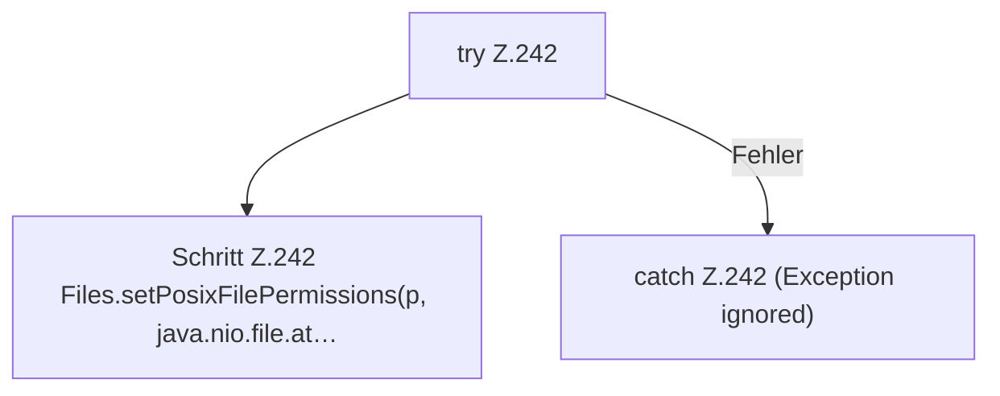

[[00 Start]] › [[Plugin-Kern]] › [[Lebenszyklus]] › [[FabricLauncherPlugin.makeWritable]]

# FabricLauncherPlugin.makeWritable

`FabricLauncherPlugin.makeWritable(Path p, boolean dir)` [src/main/java/de/aichele/childlauncher/FabricLauncherPlugin.java:241–243](https://github.com/Sciddie/minecraft-serverhoster-plugin/blob/95b02b953b0b4c23673e900e021a7c3c844aa37d/src/main/java/de/aichele/childlauncher/FabricLauncherPlugin.java#L241-L243)



```knoten
try Z.242
  Das Programm versucht diesen Schritt. Geht er schief, führt der andere Weg weiter. Das steht in [[Glossar#Zeile|Zeile]] 242.
Schritt Z.242 Files.setPosixFilePermissions(p, java.nio.file.at…
  Ein einzelner Arbeitsschritt, ohne eine weitere eigene [[Glossar#Funktion|Funktion]] aufzurufen. Das steht in [[Glossar#Zeile|Zeile]] 242.
catch Z.242 (Exception ignored)
  Dieser Weg gilt, wenn der Schritt davor schiefgegangen ist. Das steht in [[Glossar#Zeile|Zeile]] 242.
```

> [!knoten]- Was die Blöcke tun
> - **try Z.242**: Das Programm versucht diesen Schritt. Geht er schief, führt der andere Weg weiter. Das steht in [[Glossar#Zeile|Zeile]] 242.
> - **Schritt Z.242 Files.setPosixFilePermissions(p, java.nio.file.at…**: Ein einzelner Arbeitsschritt, ohne eine weitere eigene [[Glossar#Funktion|Funktion]] aufzurufen. Das steht in [[Glossar#Zeile|Zeile]] 242.
> - **catch Z.242 (Exception ignored)**: Dieser Weg gilt, wenn der Schritt davor schiefgegangen ist. Das steht in [[Glossar#Zeile|Zeile]] 242.

- Setzt die [[Glossar#Dateirechte|Dateirechte]] eines Ordners oder einer Datei sehr offen, damit der [[Glossar#Spielserver|Spielserver]] dort schreiben kann.
- Auffällig: das kann sich anders verhalten, als man erwartet. Das nennt man [[Glossar#Unerwartetes Verhalten|Unerwartetes Verhalten]].
