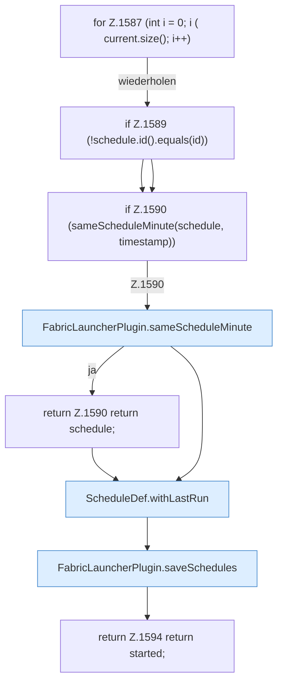

[[00 Start]] › [[Zeitplaene]] › [[Schedules]] › [[FabricLauncherPlugin.markManualScheduleRun]] › [[FabricLauncherPlugin.markManualScheduleRun.Z1584.Z1587]]

# FabricLauncherPlugin.markManualScheduleRun.Z1584.Z1587



```knoten
for Z.1587 (int i = 0; i ( current.size(); i++)
  Zeile 1587: Schleife `(int i = 0; i ( current.size(); i++)`.
if Z.1589 (!schedule.id().equals(id))
  Zeile 1589: prüft `(!schedule.id().equals(id))`.
if Z.1590 (sameScheduleMinute(schedule, timestamp))
  Zeile 1590: prüft `(sameScheduleMinute(schedule, timestamp))`.
FabricLauncherPlugin.sameScheduleMinute
  Das [[Glossar#Plugin|Plugin]] plant Zeitpunkt. Vergleicht `sameScheduleMinute`.
return Z.1590 return schedule;
  Zeile 1590: Rückgabe `return schedule;`.
ScheduleDef.withLastRun
  Der [[Glossar#Zeitplan|Zeitplan]] kümmert sich um den letzten Stand den Lauf. Liefert eine Kopie mit `withLastRun`. Ruft `ScheduleDef`.
FabricLauncherPlugin.saveSchedules
  Das [[Glossar#Plugin|Plugin]] speichert die Zeitpläne. Speichert `saveSchedules`. Ruft `toConfig`, `saveConfigWritable`.
return Z.1594 return started;
  Zeile 1594: Rückgabe `return started;`.
```

> [!knoten]- Was die Blöcke tun
> - **for Z.1587 (int i = 0; i ( current.size(); i++)**: Zeile 1587: Schleife `(int i = 0; i ( current.size(); i++)`.
> - **if Z.1589 (!schedule.id().equals(id))**: Zeile 1589: prüft `(!schedule.id().equals(id))`.
> - **if Z.1590 (sameScheduleMinute(schedule, timestamp))**: Zeile 1590: prüft `(sameScheduleMinute(schedule, timestamp))`.
> - **FabricLauncherPlugin.sameScheduleMinute**: Das [[Glossar#Plugin|Plugin]] plant Zeitpunkt. Vergleicht `sameScheduleMinute`.
> - **return Z.1590 return schedule;**: Zeile 1590: Rückgabe `return schedule;`.
> - **ScheduleDef.withLastRun**: Der [[Glossar#Zeitplan|Zeitplan]] kümmert sich um den letzten Stand den Lauf. Liefert eine Kopie mit `withLastRun`. Ruft `ScheduleDef`.
> - **FabricLauncherPlugin.saveSchedules**: Das [[Glossar#Plugin|Plugin]] speichert die Zeitpläne. Speichert `saveSchedules`. Ruft `toConfig`, `saveConfigWritable`.
> - **return Z.1594 return started;**: Zeile 1594: Rückgabe `return started;`.

- Der Ablauf geht in [[Glossar#Zeile|Zeile]] 1587 weiter. Eine Ebene tiefer steht er genauer.
- Fortsetzung von `FabricLauncherPlugin.markManualScheduleRun.Z1584`.
