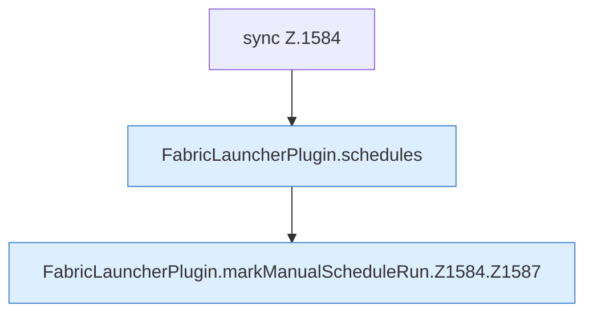

[[00 Start]] › [[Zeitplaene]] › [[Schedules]] › [[FabricLauncherPlugin.markManualScheduleRun]] › [[FabricLauncherPlugin.markManualScheduleRun.Z1584]]

# FabricLauncherPlugin.markManualScheduleRun.Z1584



```knoten
sync Z.1584
  Zeile 1584: synchronisierter Block.
FabricLauncherPlugin.schedules
  `schedules` in `FabricLauncherPlugin.java`. Ruft `load`.
FabricLauncherPlugin.markManualScheduleRun.Z1584.Z1587
  Fortsetzung des Ablaufs ab Zeile 1587.
```

- Fortsetzung von `FabricLauncherPlugin.markManualScheduleRun`, Quellreihenfolge.
