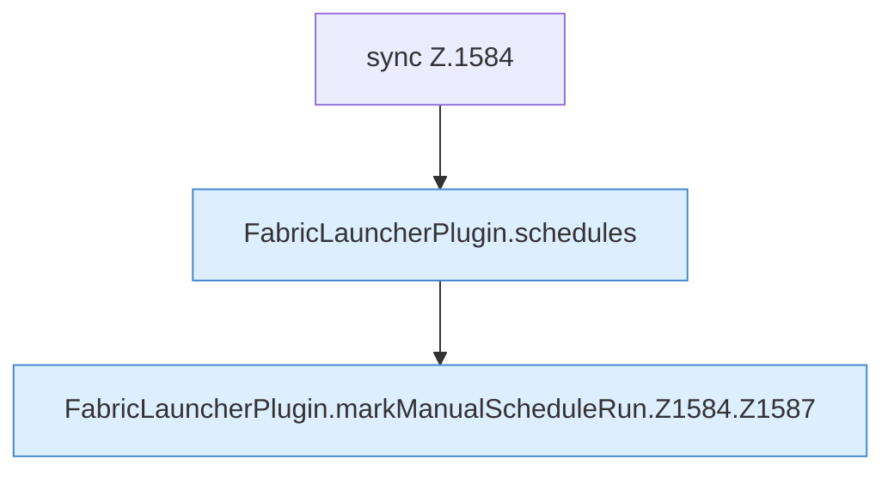

[[00 Start]] › [[Zeitplaene]] › [[Schedules]] › [[FabricLauncherPlugin.markManualScheduleRun]] › [[FabricLauncherPlugin.markManualScheduleRun.Z1584]]

# FabricLauncherPlugin.markManualScheduleRun.Z1584



```knoten
sync Z.1584
  Zeile 1584: synchronisierter Block.
FabricLauncherPlugin.schedules
  Das [[Glossar#Plugin|Plugin]] macht hier einen einzelnen Schritt. Eine Ebene tiefer steht er genauer. `schedules` in `FabricLauncherPlugin.java`. Ruft `load`.
FabricLauncherPlugin.markManualScheduleRun.Z1584.Z1587
  Der Ablauf geht in [[Glossar#Zeile|Zeile]] 1587 weiter. Eine Ebene tiefer steht er genauer. Fortsetzung des Ablaufs ab Zeile 1587.
```

> [!knoten]- Was die Blöcke tun
> - **sync Z.1584**: Zeile 1584: synchronisierter Block.
> - **FabricLauncherPlugin.schedules**: Das [[Glossar#Plugin|Plugin]] macht hier einen einzelnen Schritt. Eine Ebene tiefer steht er genauer. `schedules` in `FabricLauncherPlugin.java`. Ruft `load`.
> - **FabricLauncherPlugin.markManualScheduleRun.Z1584.Z1587**: Der Ablauf geht in [[Glossar#Zeile|Zeile]] 1587 weiter. Eine Ebene tiefer steht er genauer. Fortsetzung des Ablaufs ab Zeile 1587.

- Der Ablauf geht in [[Glossar#Zeile|Zeile]] 1584 weiter. Eine Ebene tiefer steht er genauer.
- Fortsetzung von `FabricLauncherPlugin.markManualScheduleRun`.
