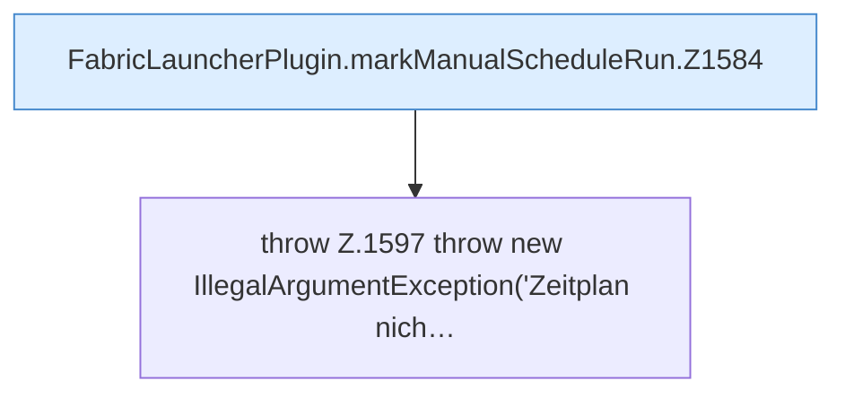

[[00 Start]] › [[Zeitplaene]] › [[Schedules]] › [[FabricLauncherPlugin.markManualScheduleRun]]

# FabricLauncherPlugin.markManualScheduleRun

`FabricLauncherPlugin.markManualScheduleRun(String id, long timestamp)` [src/main/java/de/aichele/childlauncher/FabricLauncherPlugin.java:1584–1598](https://github.com/Sciddie/minecraft-serverhoster-plugin/blob/95b02b953b0b4c23673e900e021a7c3c844aa37d/src/main/java/de/aichele/childlauncher/FabricLauncherPlugin.java#L1584-L1598)



```knoten
FabricLauncherPlugin.markManualScheduleRun.Z1584
  Der Ablauf geht in [[Glossar#Zeile|Zeile]] 1584 weiter. Eine Ebene tiefer steht er genauer. Im [[Glossar#Quelltext|Quelltext]] heißt das `Z1584`.
throw Z.1597 throw new IllegalArgumentException('Zeitplan nich…
  Hier bricht die [[Glossar#Funktion|Funktion]] ab, weil etwas nicht geklappt hat. Das steht in [[Glossar#Zeile|Zeile]] 1597.
```

> [!knoten]- Was die Blöcke tun
> - **FabricLauncherPlugin.markManualScheduleRun.Z1584**: Der Ablauf geht in [[Glossar#Zeile|Zeile]] 1584 weiter. Eine Ebene tiefer steht er genauer. Im [[Glossar#Quelltext|Quelltext]] heißt das `Z1584`.
> - **throw Z.1597 throw new IllegalArgumentException('Zeitplan nich…**: Hier bricht die [[Glossar#Funktion|Funktion]] ab, weil etwas nicht geklappt hat. Das steht in [[Glossar#Zeile|Zeile]] 1597.

- Das [[Glossar#Plugin|Plugin]] merkt sich die Handarbeit den [[Glossar#Zeitplan|Zeitplan]] den Lauf.
