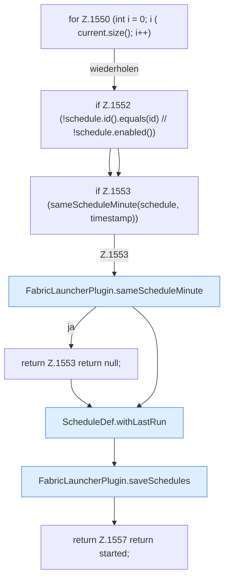

[[00 Start]] › [[Zeitplaene]] › [[Schedules]] › [[FabricLauncherPlugin.markScheduleRun]] › [[FabricLauncherPlugin.markScheduleRun.Z1547.Z1550]]

# FabricLauncherPlugin.markScheduleRun.Z1547.Z1550



```knoten
for Z.1550 (int i = 0; i ( current.size(); i++)
  Zeile 1550: Schleife `(int i = 0; i ( current.size(); i++)`.
if Z.1552 (!schedule.id().equals(id) // !schedule.enabled())
  Zeile 1552: prüft `(!schedule.id().equals(id) // !schedule.enabled())`.
if Z.1553 (sameScheduleMinute(schedule, timestamp))
  Zeile 1553: prüft `(sameScheduleMinute(schedule, timestamp))`.
FabricLauncherPlugin.sameScheduleMinute
  Vergleicht `sameScheduleMinute`.
return Z.1553 return null;
  Zeile 1553: Rückgabe `return null;`.
ScheduleDef.withLastRun
  Liefert eine Kopie mit `withLastRun`. Ruft `ScheduleDef`.
FabricLauncherPlugin.saveSchedules
  Speichert `saveSchedules`. Ruft `toConfig`, `saveConfigWritable`.
return Z.1557 return started;
  Zeile 1557: Rückgabe `return started;`.
```

- Fortsetzung von `FabricLauncherPlugin.markScheduleRun.Z1547`, Quellreihenfolge.
