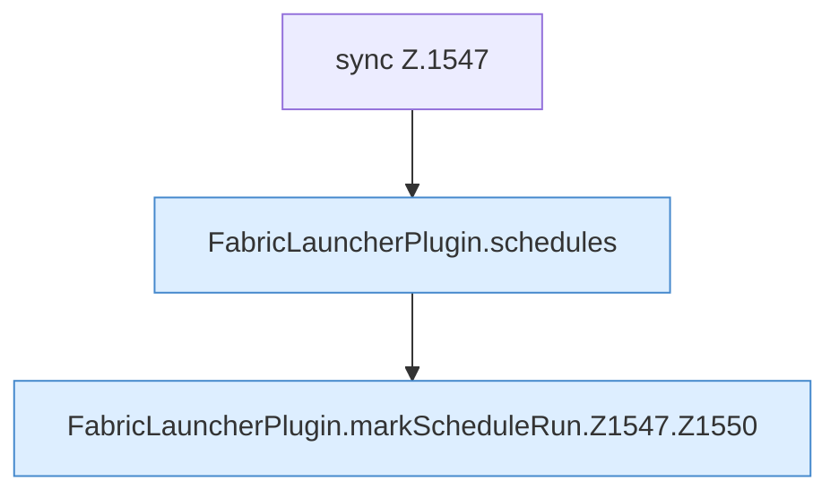

[[00 Start]] › [[Zeitplaene]] › [[Schedules]] › [[FabricLauncherPlugin.markScheduleRun]] › [[FabricLauncherPlugin.markScheduleRun.Z1547]]

# FabricLauncherPlugin.markScheduleRun.Z1547

- Fortsetzung von `FabricLauncherPlugin.markScheduleRun`, Quellreihenfolge.
