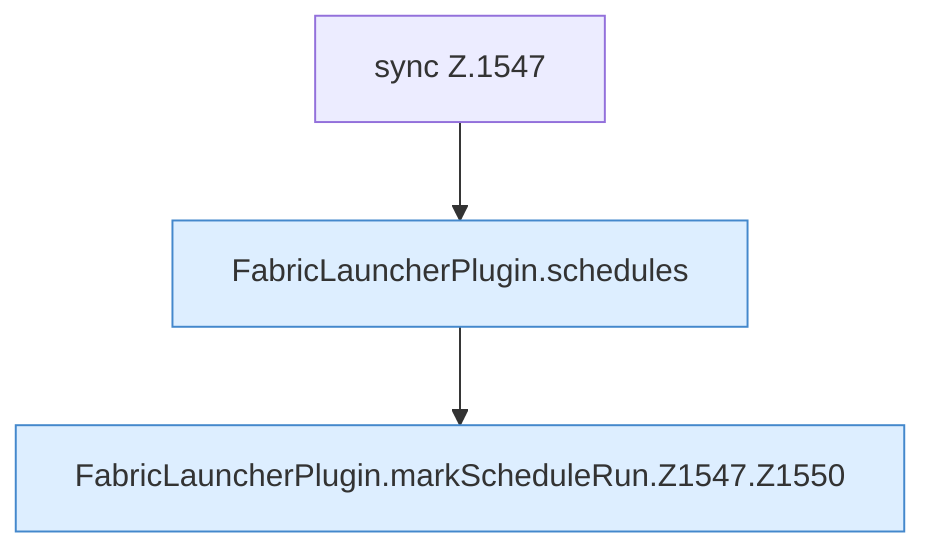

[[00 Start]] › [[Zeitplaene]] › [[Schedules]] › [[FabricLauncherPlugin.markScheduleRun]] › [[FabricLauncherPlugin.markScheduleRun.Z1547]]

# FabricLauncherPlugin.markScheduleRun.Z1547



```knoten
sync Z.1547
  Zeile 1547: synchronisierter Block.
FabricLauncherPlugin.schedules
  Das [[Glossar#Plugin|Plugin]] macht hier einen einzelnen Schritt. Eine Ebene tiefer steht er genauer. `schedules` in `FabricLauncherPlugin.java`. Ruft `load`.
FabricLauncherPlugin.markScheduleRun.Z1547.Z1550
  Der Ablauf geht in [[Glossar#Zeile|Zeile]] 1550 weiter. Eine Ebene tiefer steht er genauer. Fortsetzung des Ablaufs ab Zeile 1550.
```

> [!knoten]- Was die Blöcke tun
> - **sync Z.1547**: Zeile 1547: synchronisierter Block.
> - **FabricLauncherPlugin.schedules**: Das [[Glossar#Plugin|Plugin]] macht hier einen einzelnen Schritt. Eine Ebene tiefer steht er genauer. `schedules` in `FabricLauncherPlugin.java`. Ruft `load`.
> - **FabricLauncherPlugin.markScheduleRun.Z1547.Z1550**: Der Ablauf geht in [[Glossar#Zeile|Zeile]] 1550 weiter. Eine Ebene tiefer steht er genauer. Fortsetzung des Ablaufs ab Zeile 1550.

- Der Ablauf geht in [[Glossar#Zeile|Zeile]] 1547 weiter. Eine Ebene tiefer steht er genauer.
- Fortsetzung von `FabricLauncherPlugin.markScheduleRun`.
