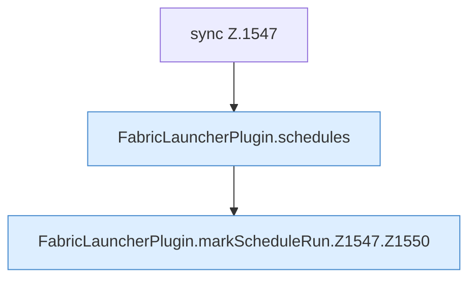

[[00 Start]] › [[Zeitplaene]] › [[Schedules]] › [[FabricLauncherPlugin.markScheduleRun]] › [[FabricLauncherPlugin.markScheduleRun.Z1547]]

# FabricLauncherPlugin.markScheduleRun.Z1547



```knoten
sync Z.1547
  Zeile 1547: synchronisierter Block.
FabricLauncherPlugin.schedules
  `schedules` in `FabricLauncherPlugin.java`. Ruft `load`.
FabricLauncherPlugin.markScheduleRun.Z1547.Z1550
  Fortsetzung des Ablaufs ab Zeile 1550.
```

- Fortsetzung von `FabricLauncherPlugin.markScheduleRun`, Quellreihenfolge.
