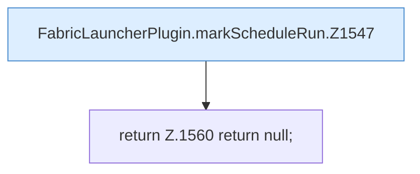

[[00 Start]] › [[Zeitplaene]] › [[Schedules]] › [[FabricLauncherPlugin.markScheduleRun]]

# FabricLauncherPlugin.markScheduleRun

`FabricLauncherPlugin.markScheduleRun(String id, long timestamp)` [src/main/java/de/aichele/childlauncher/FabricLauncherPlugin.java:1547–1561](https://github.com/Sciddie/minecraft-serverhoster-plugin/blob/95b02b953b0b4c23673e900e021a7c3c844aa37d/src/main/java/de/aichele/childlauncher/FabricLauncherPlugin.java#L1547-L1561)



```knoten
FabricLauncherPlugin.markScheduleRun.Z1547
  Fortsetzung des Ablaufs ab Zeile 1547.
return Z.1560 return null;
  Zeile 1560: Rückgabe `return null;`.
```

- `markScheduleRun` in `src/main/java/de/aichele/childlauncher/FabricLauncherPlugin.java`
