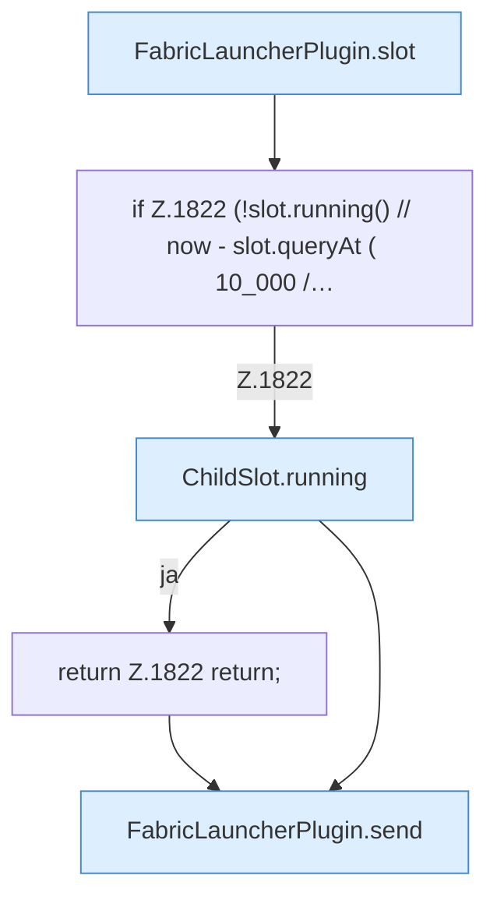
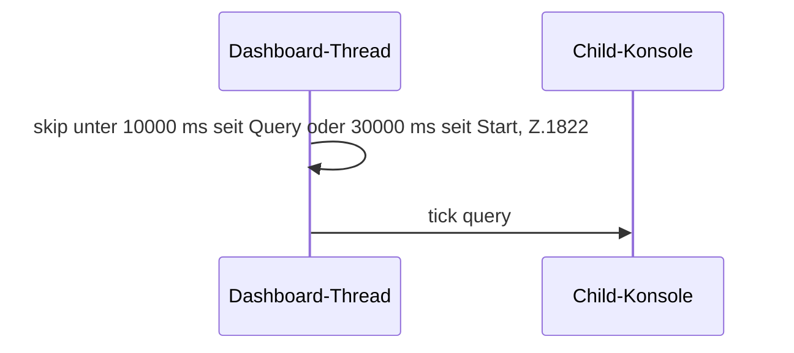

[[00 Start]] › [[Child-Prozess]] › [[Pipe-Watch]] › [[FabricLauncherPlugin.maybeQueryChildTick]]

# FabricLauncherPlugin.maybeQueryChildTick

`FabricLauncherPlugin.maybeQueryChildTick(String id)` [src/main/java/de/aichele/childlauncher/FabricLauncherPlugin.java:1819–1825](https://github.com/Sciddie/minecraft-serverhoster-plugin/blob/95b02b953b0b4c23673e900e021a7c3c844aa37d/src/main/java/de/aichele/childlauncher/FabricLauncherPlugin.java#L1819-L1825)



```knoten
FabricLauncherPlugin.slot
  Das [[Glossar#Plugin|Plugin]] macht hier einen einzelnen Schritt. Eine Ebene tiefer steht er genauer. Im [[Glossar#Quelltext|Quelltext]] heißt das `slot`.
if Z.1822 (!slot.running() // now - slot.queryAt ( 10_000 /…
  Hier fällt eine Entscheidung. Nur wenn sie zutrifft, geht es den Ja-Weg weiter. Das steht in [[Glossar#Zeile|Zeile]] 1822.
ChildSlot.running
  Dieser Teil prüft, ob läuft, das. Im [[Glossar#Quelltext|Quelltext]] heißt das `running`.
return Z.1822 return;
  Hier endet die [[Glossar#Funktion|Funktion]] und liefert ein Ergebnis zurück. Das steht in [[Glossar#Zeile|Zeile]] 1822.
FabricLauncherPlugin.send
  Schickt Text an den laufenden [[Glossar#Spielserver|Spielserver]]. Im [[Glossar#Quelltext|Quelltext]] heißt das `send`.
```

> [!knoten]- Was die Blöcke tun
> - **FabricLauncherPlugin.slot**: Das [[Glossar#Plugin|Plugin]] macht hier einen einzelnen Schritt. Eine Ebene tiefer steht er genauer. Im [[Glossar#Quelltext|Quelltext]] heißt das `slot`.
> - **if Z.1822 (!slot.running() // now - slot.queryAt ( 10_000 /…**: Hier fällt eine Entscheidung. Nur wenn sie zutrifft, geht es den Ja-Weg weiter. Das steht in [[Glossar#Zeile|Zeile]] 1822.
> - **ChildSlot.running**: Dieser Teil prüft, ob läuft, das. Im [[Glossar#Quelltext|Quelltext]] heißt das `running`.
> - **return Z.1822 return;**: Hier endet die [[Glossar#Funktion|Funktion]] und liefert ein Ergebnis zurück. Das steht in [[Glossar#Zeile|Zeile]] 1822.
> - **FabricLauncherPlugin.send**: Schickt Text an den laufenden [[Glossar#Spielserver|Spielserver]]. Im [[Glossar#Quelltext|Quelltext]] heißt das `send`.



- Fragt nur ab und zu nach dem letzten [[Glossar#Spielschritt|Spielschritt]], frühestens eine halbe Minute nach dem Start und danach höchstens alle zehn Sekunden.
