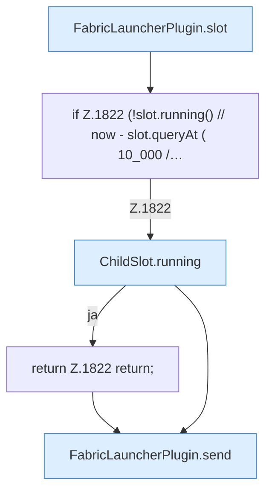
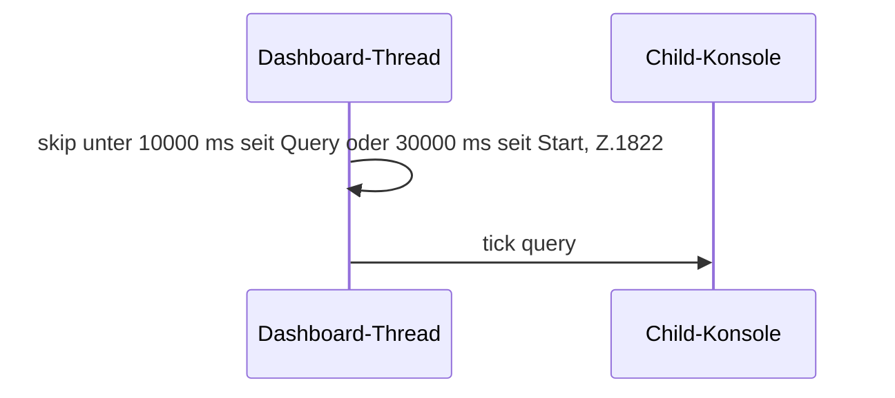

[[00 Start]] › [[Child-Prozess]] › [[Pipe-Watch]] › [[FabricLauncherPlugin.maybeQueryChildTick]]

# FabricLauncherPlugin.maybeQueryChildTick

`FabricLauncherPlugin.maybeQueryChildTick(String id)` [src/main/java/de/aichele/childlauncher/FabricLauncherPlugin.java:1819–1825](https://github.com/Sciddie/minecraft-serverhoster-plugin/blob/95b02b953b0b4c23673e900e021a7c3c844aa37d/src/main/java/de/aichele/childlauncher/FabricLauncherPlugin.java#L1819-L1825)



```knoten
FabricLauncherPlugin.slot
  `slot` in `FabricLauncherPlugin.java`. Ruft `profile`, `ChildSlot`.
if Z.1822 (!slot.running() // now - slot.queryAt ( 10_000 /…
  Zeile 1822: prüft `(!slot.running() // now - slot.queryAt ( 10_000 /…`.
ChildSlot.running
  Sagt, ob der Prozess läuft `running`.
return Z.1822 return;
  Zeile 1822: Rückgabe `return;`.
FabricLauncherPlugin.send
  Sendet `send`. Ruft `running`.
```



- `maybeQueryChildTick` in `src/main/java/de/aichele/childlauncher/FabricLauncherPlugin.java`
