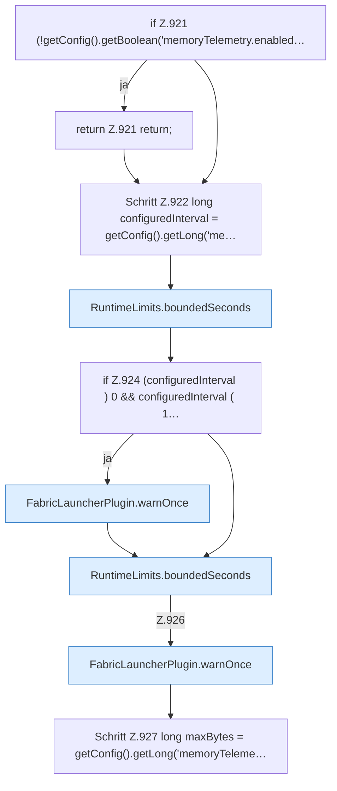

[[00 Start]] › [[Host-Betrieb]] › [[Speicher-Probe]] › [[FabricLauncherPlugin.maybeWriteTelemetry]] › [[FabricLauncherPlugin.maybeWriteTelemetry.Teil1]]

# FabricLauncherPlugin.maybeWriteTelemetry.Teil1



```knoten
if Z.921 (!getConfig().getBoolean('memoryTelemetry.enabled…
  Zeile 921: prüft `(!getConfig().getBoolean('memoryTelemetry.enabled…`.
return Z.921 return;
  Zeile 921: Rückgabe `return;`.
Schritt Z.922 long configuredInterval = getConfig().getLong('me…
  Zeile 922: liest die Config. `long configuredInterval = getConfig().getLong('me…`
RuntimeLimits.boundedSeconds
  Dieser Teil macht hier einen einzelnen Schritt. Eine Ebene tiefer steht er genauer. Begrenzt `boundedSeconds`.
if Z.924 (configuredInterval ) 0 && configuredInterval ( 1…
  Zeile 924: prüft `(configuredInterval ) 0 && configuredInterval ( 1…`.
FabricLauncherPlugin.warnOnce
  Schreibt eine Warnung nur ein einziges Mal, damit das Protokoll nicht vollläuft. Warnt `warnOnce`.
Schritt Z.927 long maxBytes = getConfig().getLong('memoryTeleme…
  Zeile 927: liest die Config. `long maxBytes = getConfig().getLong('memoryTeleme…`
```

> [!knoten]- Was die Blöcke tun
> - **if Z.921 (!getConfig().getBoolean('memoryTelemetry.enabled…**: Zeile 921: prüft `(!getConfig().getBoolean('memoryTelemetry.enabled…`.
> - **return Z.921 return;**: Zeile 921: Rückgabe `return;`.
> - **Schritt Z.922 long configuredInterval = getConfig().getLong('me…**: Zeile 922: liest die Config. `long configuredInterval = getConfig().getLong('me…`
> - **RuntimeLimits.boundedSeconds**: Dieser Teil macht hier einen einzelnen Schritt. Eine Ebene tiefer steht er genauer. Begrenzt `boundedSeconds`.
> - **if Z.924 (configuredInterval ) 0 && configuredInterval ( 1…**: Zeile 924: prüft `(configuredInterval ) 0 && configuredInterval ( 1…`.
> - **FabricLauncherPlugin.warnOnce**: Schreibt eine Warnung nur ein einziges Mal, damit das Protokoll nicht vollläuft. Warnt `warnOnce`.
> - **Schritt Z.927 long maxBytes = getConfig().getLong('memoryTeleme…**: Zeile 927: liest die Config. `long maxBytes = getConfig().getLong('memoryTeleme…`

- Ein weiterer Abschnitt derselben Übersicht.
- Fortsetzung von `FabricLauncherPlugin.maybeWriteTelemetry`.
