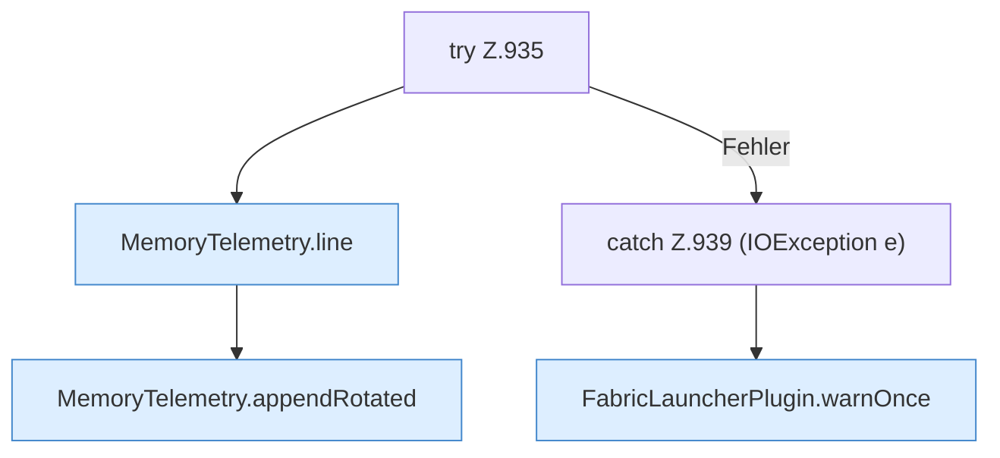

[[00 Start]] › [[Host-Betrieb]] › [[Speicher-Probe]] › [[FabricLauncherPlugin.maybeWriteTelemetry]] › [[FabricLauncherPlugin.maybeWriteTelemetry.Teil2.Z935]]

# FabricLauncherPlugin.maybeWriteTelemetry.Teil2.Z935



```knoten
try Z.935
  Zeile 935: Versuch. Der Fehlerpfad geht in catch.
MemoryTelemetry.line
  `line` in `MemoryTelemetry.java`. Ruft `usedMiB`, `committedMiB`, `maxMiB`.
MemoryTelemetry.appendRotated
  Hängt an `appendRotated`.
catch Z.939 (IOException e)
  Zeile 939: fängt (IOException e).
FabricLauncherPlugin.warnOnce
  Warnt `warnOnce`.
```

- Fortsetzung von `FabricLauncherPlugin.maybeWriteTelemetry.Teil2`, Quellreihenfolge.
