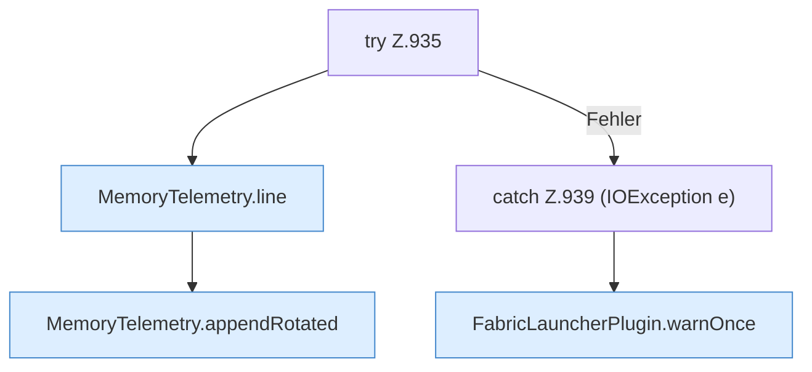

[[00 Start]] › [[Host-Betrieb]] › [[Speicher-Probe]] › [[FabricLauncherPlugin.maybeWriteTelemetry]] › [[FabricLauncherPlugin.maybeWriteTelemetry.Teil2.Z935]]

# FabricLauncherPlugin.maybeWriteTelemetry.Teil2.Z935



```knoten
try Z.935
  Zeile 935: Versuch. Der Fehlerpfad geht in catch.
MemoryTelemetry.line
  Die Messung macht hier einen einzelnen Schritt. Eine Ebene tiefer steht er genauer. `line` in `MemoryTelemetry.java`. Ruft `usedMiB`, `committedMiB`, `maxMiB`.
MemoryTelemetry.appendRotated
  Die Messung macht hier einen einzelnen Schritt. Eine Ebene tiefer steht er genauer. Hängt an `appendRotated`.
catch Z.939 (IOException e)
  Zeile 939: fängt (IOException e).
FabricLauncherPlugin.warnOnce
  Schreibt eine Warnung nur ein einziges Mal, damit das Protokoll nicht vollläuft. Warnt `warnOnce`.
```

> [!knoten]- Was die Blöcke tun
> - **try Z.935**: Zeile 935: Versuch. Der Fehlerpfad geht in catch.
> - **MemoryTelemetry.line**: Die Messung macht hier einen einzelnen Schritt. Eine Ebene tiefer steht er genauer. `line` in `MemoryTelemetry.java`. Ruft `usedMiB`, `committedMiB`, `maxMiB`.
> - **MemoryTelemetry.appendRotated**: Die Messung macht hier einen einzelnen Schritt. Eine Ebene tiefer steht er genauer. Hängt an `appendRotated`.
> - **catch Z.939 (IOException e)**: Zeile 939: fängt (IOException e).
> - **FabricLauncherPlugin.warnOnce**: Schreibt eine Warnung nur ein einziges Mal, damit das Protokoll nicht vollläuft. Warnt `warnOnce`.

- Der Ablauf geht in [[Glossar#Zeile|Zeile]] 935 weiter. Eine Ebene tiefer steht er genauer.
- Fortsetzung von `FabricLauncherPlugin.maybeWriteTelemetry.Teil2`.
