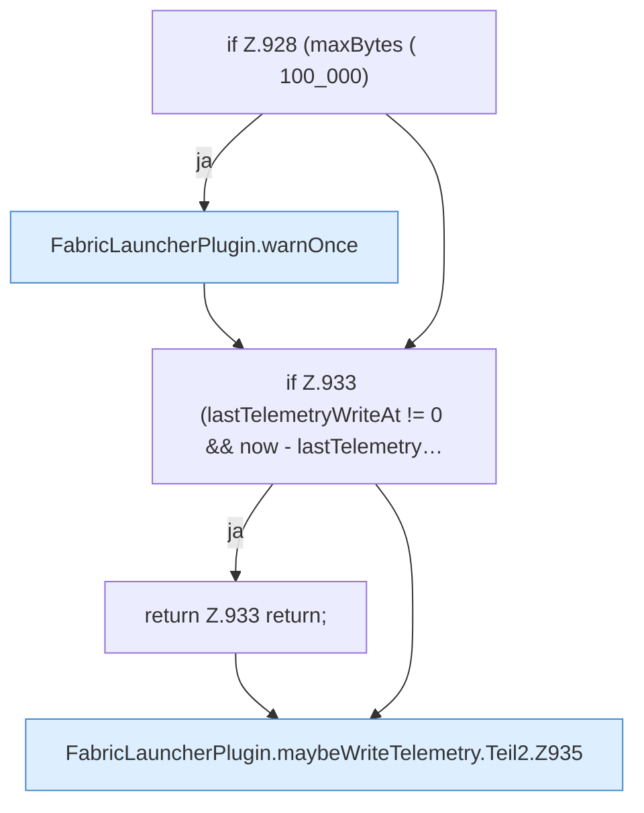

[[00 Start]] › [[Host-Betrieb]] › [[Speicher-Probe]] › [[FabricLauncherPlugin.maybeWriteTelemetry]] › [[FabricLauncherPlugin.maybeWriteTelemetry.Teil2]]

# FabricLauncherPlugin.maybeWriteTelemetry.Teil2

- Fortsetzung von `FabricLauncherPlugin.maybeWriteTelemetry`, Quellreihenfolge.
