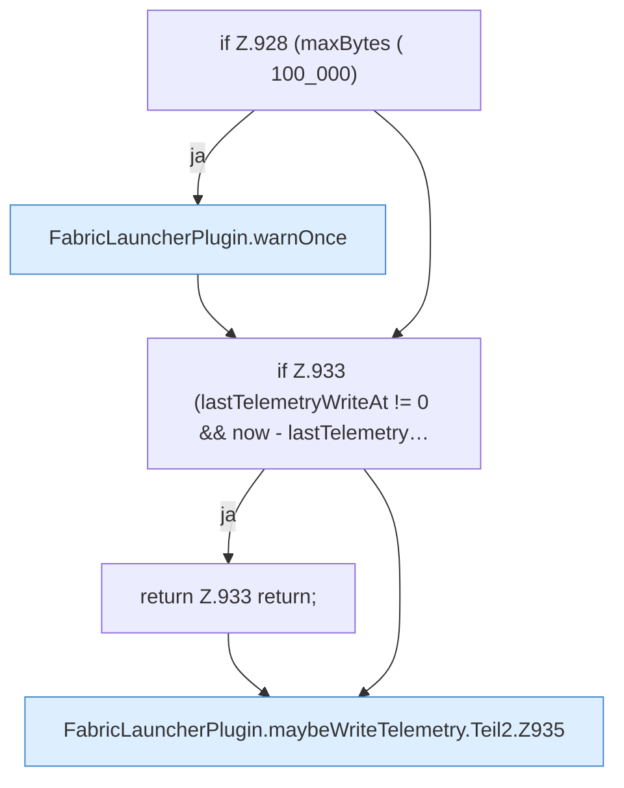

[[00 Start]] › [[Host-Betrieb]] › [[Speicher-Probe]] › [[FabricLauncherPlugin.maybeWriteTelemetry]] › [[FabricLauncherPlugin.maybeWriteTelemetry.Teil2]]

# FabricLauncherPlugin.maybeWriteTelemetry.Teil2



```knoten
if Z.928 (maxBytes ( 100_000)
  Zeile 928: prüft `(maxBytes ( 100_000)`.
FabricLauncherPlugin.warnOnce
  Schreibt eine Warnung nur ein einziges Mal, damit das Protokoll nicht vollläuft. Warnt `warnOnce`.
if Z.933 (lastTelemetryWriteAt != 0 && now - lastTelemetry…
  Zeile 933: prüft `(lastTelemetryWriteAt != 0 && now - lastTelemetry…`.
return Z.933 return;
  Zeile 933: Rückgabe `return;`.
FabricLauncherPlugin.maybeWriteTelemetry.Teil2.Z935
  Der Ablauf geht in [[Glossar#Zeile|Zeile]] 935 weiter. Eine Ebene tiefer steht er genauer. Fortsetzung des Ablaufs ab Zeile 935.
```

> [!knoten]- Was die Blöcke tun
> - **if Z.928 (maxBytes ( 100_000)**: Zeile 928: prüft `(maxBytes ( 100_000)`.
> - **FabricLauncherPlugin.warnOnce**: Schreibt eine Warnung nur ein einziges Mal, damit das Protokoll nicht vollläuft. Warnt `warnOnce`.
> - **if Z.933 (lastTelemetryWriteAt != 0 && now - lastTelemetry…**: Zeile 933: prüft `(lastTelemetryWriteAt != 0 && now - lastTelemetry…`.
> - **return Z.933 return;**: Zeile 933: Rückgabe `return;`.
> - **FabricLauncherPlugin.maybeWriteTelemetry.Teil2.Z935**: Der Ablauf geht in [[Glossar#Zeile|Zeile]] 935 weiter. Eine Ebene tiefer steht er genauer. Fortsetzung des Ablaufs ab Zeile 935.

- Ein weiterer Abschnitt derselben Übersicht.
- Fortsetzung von `FabricLauncherPlugin.maybeWriteTelemetry`.
