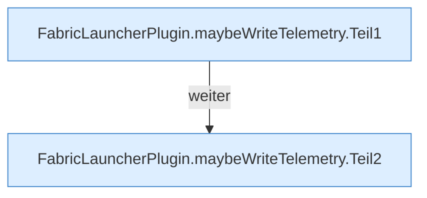

[[00 Start]] › [[Host-Betrieb]] › [[Speicher-Probe]] › [[FabricLauncherPlugin.maybeWriteTelemetry]]

# FabricLauncherPlugin.maybeWriteTelemetry

`FabricLauncherPlugin.maybeWriteTelemetry(HostMemoryProbe.Snapshot snapshot, MemoryTelemetry.Reading reading)` [src/main/java/de/aichele/childlauncher/FabricLauncherPlugin.java:920–942](https://github.com/Sciddie/minecraft-serverhoster-plugin/blob/95b02b953b0b4c23673e900e021a7c3c844aa37d/src/main/java/de/aichele/childlauncher/FabricLauncherPlugin.java#L920-L942)

- `maybeWriteTelemetry` in `src/main/java/de/aichele/childlauncher/FabricLauncherPlugin.java`
