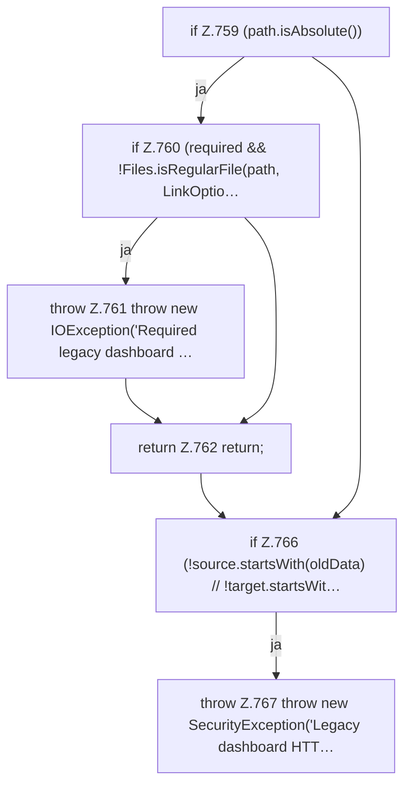

[[00 Start]] › [[Plugin-Kern]] › [[Setup]] › [[Setup-Import]] › [[FabricLauncherPlugin.migrateHttpsFile]] › [[FabricLauncherPlugin.migrateHttpsFile.Teil1]]

# FabricLauncherPlugin.migrateHttpsFile.Teil1



```knoten
if Z.759 (path.isAbsolute())
  Zeile 759: prüft `(path.isAbsolute())`.
if Z.760 (required && !Files.isRegularFile(path, LinkOptio…
  Zeile 760: prüft `(required && !Files.isRegularFile(path, LinkOptio…`.
throw Z.761 throw new IOException('Required legacy dashboard …
  Zeile 761: Abbruch `throw new IOException('Required legacy dashboard …`.
return Z.762 return;
  Zeile 762: Rückgabe `return;`.
if Z.766 (!source.startsWith(oldData) // !target.startsWit…
  Zeile 766: prüft `(!source.startsWith(oldData) // !target.startsWit…`.
throw Z.767 throw new SecurityException('Legacy dashboard HTT…
  Zeile 767: Abbruch `throw new SecurityException('Legacy dashboard HTT…`.
```

> [!knoten]- Was die Blöcke tun
> - **if Z.759 (path.isAbsolute())**: Zeile 759: prüft `(path.isAbsolute())`.
> - **if Z.760 (required && !Files.isRegularFile(path, LinkOptio…**: Zeile 760: prüft `(required && !Files.isRegularFile(path, LinkOptio…`.
> - **throw Z.761 throw new IOException('Required legacy dashboard …**: Zeile 761: Abbruch `throw new IOException('Required legacy dashboard …`.
> - **return Z.762 return;**: Zeile 762: Rückgabe `return;`.
> - **if Z.766 (!source.startsWith(oldData) // !target.startsWit…**: Zeile 766: prüft `(!source.startsWith(oldData) // !target.startsWit…`.
> - **throw Z.767 throw new SecurityException('Legacy dashboard HTT…**: Zeile 767: Abbruch `throw new SecurityException('Legacy dashboard HTT…`.

- Ein weiterer Abschnitt derselben Übersicht.
- Fortsetzung von `FabricLauncherPlugin.migrateHttpsFile`.
