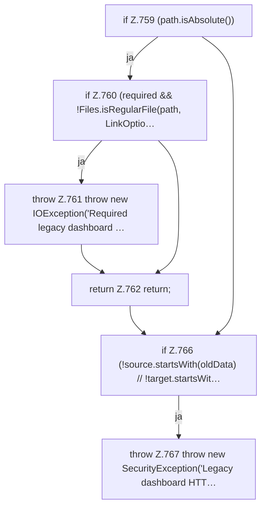

[[00 Start]] › [[Plugin-Kern]] › [[Setup]] › [[Setup-Import]] › [[FabricLauncherPlugin.migrateHttpsFile]] › [[FabricLauncherPlugin.migrateHttpsFile.Teil1]]

# FabricLauncherPlugin.migrateHttpsFile.Teil1

- Fortsetzung von `FabricLauncherPlugin.migrateHttpsFile`, Quellreihenfolge.
