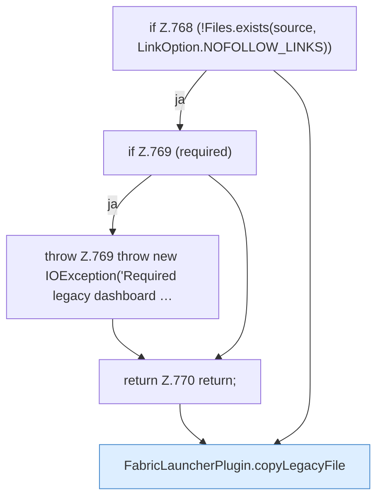

[[00 Start]] › [[Plugin-Kern]] › [[Setup]] › [[Setup-Import]] › [[FabricLauncherPlugin.migrateHttpsFile]] › [[FabricLauncherPlugin.migrateHttpsFile.Teil2]]

# FabricLauncherPlugin.migrateHttpsFile.Teil2



```knoten
if Z.768 (!Files.exists(source, LinkOption.NOFOLLOW_LINKS))
  Zeile 768: prüft `(!Files.exists(source, LinkOption.NOFOLLOW_LINKS))`.
if Z.769 (required)
  Zeile 769: prüft `(required)`.
throw Z.769 throw new IOException('Required legacy dashboard …
  Zeile 769: Abbruch `throw new IOException('Required legacy dashboard …`.
return Z.770 return;
  Zeile 770: Rückgabe `return;`.
FabricLauncherPlugin.copyLegacyFile
  Kopiert `copyLegacyFile`. Ruft `rejectSymbolicLinkSegments`.
```

- Fortsetzung von `FabricLauncherPlugin.migrateHttpsFile`, Quellreihenfolge.
