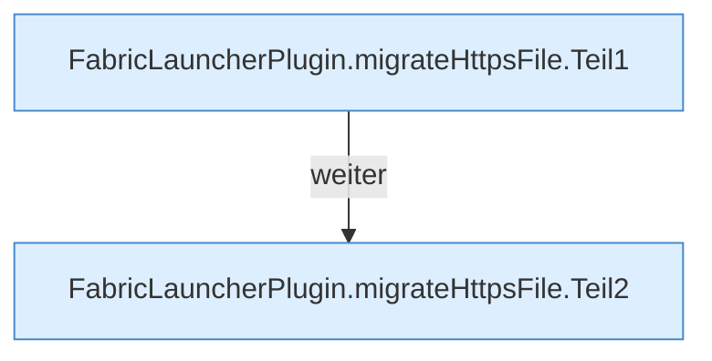

[[00 Start]] › [[Plugin-Kern]] › [[Setup]] › [[Setup-Import]] › [[FabricLauncherPlugin.migrateHttpsFile]]

# FabricLauncherPlugin.migrateHttpsFile

`FabricLauncherPlugin.migrateHttpsFile(Path oldData, String configured, boolean required, long maxBytes)` [src/main/java/de/aichele/childlauncher/FabricLauncherPlugin.java:756–773](https://github.com/Sciddie/minecraft-serverhoster-plugin/blob/95b02b953b0b4c23673e900e021a7c3c844aa37d/src/main/java/de/aichele/childlauncher/FabricLauncherPlugin.java#L756-L773)



```knoten
FabricLauncherPlugin.migrateHttpsFile.Teil1
  Abschnitt 1 dieses Ablaufs, in Quellreihenfolge.
FabricLauncherPlugin.migrateHttpsFile.Teil2
  Abschnitt 2 dieses Ablaufs, in Quellreihenfolge.
```

- `migrateHttpsFile` in `src/main/java/de/aichele/childlauncher/FabricLauncherPlugin.java`
