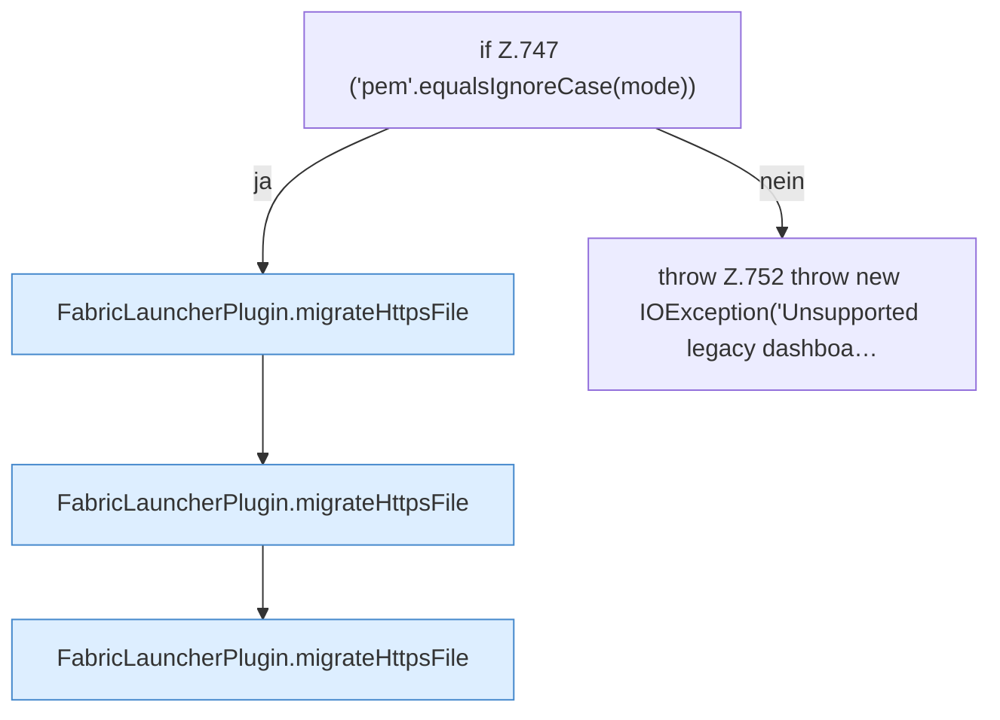

[[00 Start]] › [[Plugin-Kern]] › [[Setup]] › [[Setup-Import]] › [[FabricLauncherPlugin.migrateLegacyHttpsMaterial]] › [[FabricLauncherPlugin.migrateLegacyHttpsMaterial.Z744.Z747]]

# FabricLauncherPlugin.migrateLegacyHttpsMaterial.Z744.Z747

- Fortsetzung von `FabricLauncherPlugin.migrateLegacyHttpsMaterial.Z744`, Quellreihenfolge.
