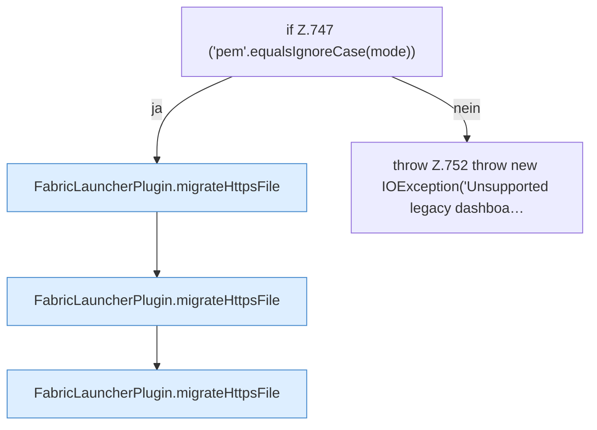

[[00 Start]] › [[Plugin-Kern]] › [[Setup]] › [[Setup-Import]] › [[FabricLauncherPlugin.migrateLegacyHttpsMaterial]] › [[FabricLauncherPlugin.migrateLegacyHttpsMaterial.Z744.Z747]]

# FabricLauncherPlugin.migrateLegacyHttpsMaterial.Z744.Z747



```knoten
if Z.747 ('pem'.equalsIgnoreCase(mode))
  Zeile 747: prüft `('pem'.equalsIgnoreCase(mode))`.
FabricLauncherPlugin.migrateHttpsFile
  Das [[Glossar#Plugin|Plugin]] übernimmt den alten Wert von die [[Glossar#Verschlüsselung|Verschlüsselung]] die Datei. Übernimmt den alten Wert von `migrateHttpsFile`. Ruft `copyLegacyFile`.
throw Z.752 throw new IOException('Unsupported legacy dashboa…
  Zeile 752: Abbruch `throw new IOException('Unsupported legacy dashboa…`.
```

> [!knoten]- Was die Blöcke tun
> - **if Z.747 ('pem'.equalsIgnoreCase(mode))**: Zeile 747: prüft `('pem'.equalsIgnoreCase(mode))`.
> - **FabricLauncherPlugin.migrateHttpsFile**: Das [[Glossar#Plugin|Plugin]] übernimmt den alten Wert von die [[Glossar#Verschlüsselung|Verschlüsselung]] die Datei. Übernimmt den alten Wert von `migrateHttpsFile`. Ruft `copyLegacyFile`.
> - **throw Z.752 throw new IOException('Unsupported legacy dashboa…**: Zeile 752: Abbruch `throw new IOException('Unsupported legacy dashboa…`.

- Der Ablauf geht in [[Glossar#Zeile|Zeile]] 747 weiter. Eine Ebene tiefer steht er genauer.
- Fortsetzung von `FabricLauncherPlugin.migrateLegacyHttpsMaterial.Z744`.
