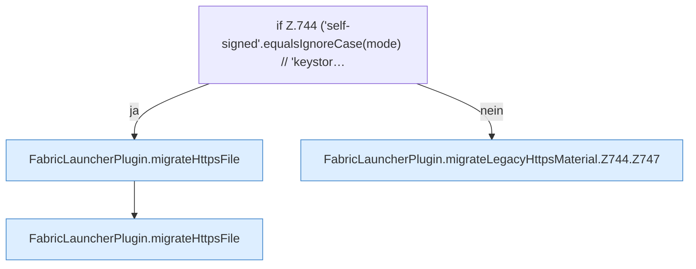

[[00 Start]] › [[Plugin-Kern]] › [[Setup]] › [[Setup-Import]] › [[FabricLauncherPlugin.migrateLegacyHttpsMaterial]] › [[FabricLauncherPlugin.migrateLegacyHttpsMaterial.Z744]]

# FabricLauncherPlugin.migrateLegacyHttpsMaterial.Z744



```knoten
if Z.744 ('self-signed'.equalsIgnoreCase(mode) // 'keystor…
  Zeile 744: prüft `('self-signed'.equalsIgnoreCase(mode) // 'keystor…`.
FabricLauncherPlugin.migrateHttpsFile
  Übernimmt den alten Wert von `migrateHttpsFile`. Ruft `copyLegacyFile`.
FabricLauncherPlugin.migrateLegacyHttpsMaterial.Z744.Z747
  Fortsetzung des Ablaufs ab Zeile 747.
```

- Fortsetzung von `FabricLauncherPlugin.migrateLegacyHttpsMaterial`, Quellreihenfolge.
