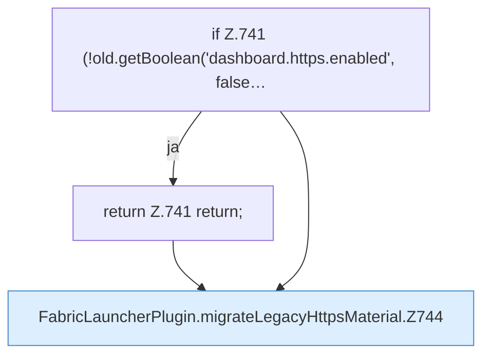

[[00 Start]] › [[Plugin-Kern]] › [[Setup]] › [[Setup-Import]] › [[FabricLauncherPlugin.migrateLegacyHttpsMaterial]]

# FabricLauncherPlugin.migrateLegacyHttpsMaterial

`FabricLauncherPlugin.migrateLegacyHttpsMaterial(Path oldData, FileConfiguration old)` [src/main/java/de/aichele/childlauncher/FabricLauncherPlugin.java:740–754](https://github.com/Sciddie/minecraft-serverhoster-plugin/blob/95b02b953b0b4c23673e900e021a7c3c844aa37d/src/main/java/de/aichele/childlauncher/FabricLauncherPlugin.java#L740-L754)



```knoten
if Z.741 (!old.getBoolean('dashboard.https.enabled', false…
  Zeile 741: prüft `(!old.getBoolean('dashboard.https.enabled', false…`.
return Z.741 return;
  Zeile 741: Rückgabe `return;`.
FabricLauncherPlugin.migrateLegacyHttpsMaterial.Z744
  Der Ablauf geht in [[Glossar#Zeile|Zeile]] 744 weiter. Eine Ebene tiefer steht er genauer. Fortsetzung des Ablaufs ab Zeile 744.
```

> [!knoten]- Was die Blöcke tun
> - **if Z.741 (!old.getBoolean('dashboard.https.enabled', false…**: Zeile 741: prüft `(!old.getBoolean('dashboard.https.enabled', false…`.
> - **return Z.741 return;**: Zeile 741: Rückgabe `return;`.
> - **FabricLauncherPlugin.migrateLegacyHttpsMaterial.Z744**: Der Ablauf geht in [[Glossar#Zeile|Zeile]] 744 weiter. Eine Ebene tiefer steht er genauer. Fortsetzung des Ablaufs ab Zeile 744.

- Das [[Glossar#Plugin|Plugin]] übernimmt den alten Wert von den alten Weg die [[Glossar#Verschlüsselung|Verschlüsselung]].
- `migrateLegacyHttpsMaterial` in `src/main/java/de/aichele/childlauncher/FabricLauncherPlugin.java`
