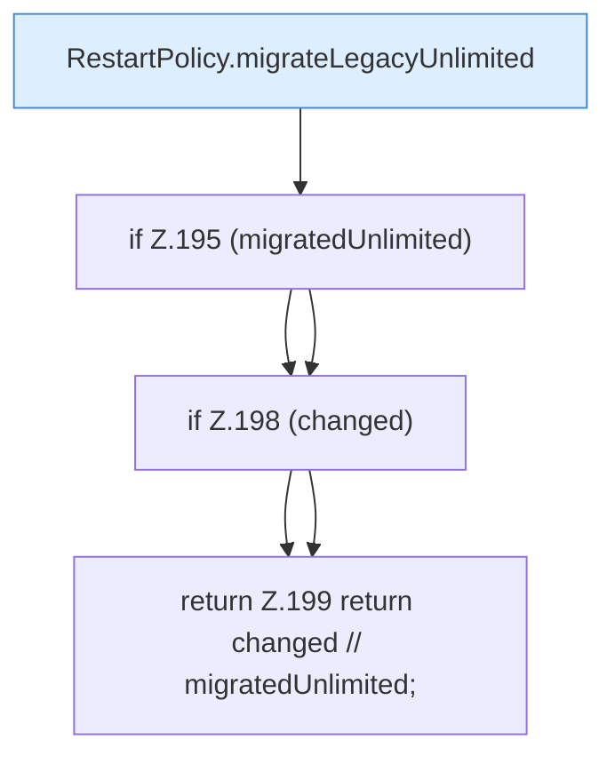

[[00 Start]] › [[Plugin-Kern]] › [[Lebenszyklus]] › [[FabricLauncherPlugin.migrateLegacyRestartPolicy]]

# FabricLauncherPlugin.migrateLegacyRestartPolicy

`FabricLauncherPlugin.migrateLegacyRestartPolicy(FileConfiguration config, String currentVersion)` [src/main/java/de/aichele/childlauncher/FabricLauncherPlugin.java:191–200](https://github.com/Sciddie/minecraft-serverhoster-plugin/blob/95b02b953b0b4c23673e900e021a7c3c844aa37d/src/main/java/de/aichele/childlauncher/FabricLauncherPlugin.java#L191-L200)



```knoten
RestartPolicy.migrateLegacyUnlimited
  Übernimmt den alten Wert von `migrateLegacyUnlimited`.
if Z.195 (migratedUnlimited)
  Zeile 195: prüft `(migratedUnlimited)`.
if Z.198 (changed)
  Zeile 198: prüft `(changed)`.
return Z.199 return changed // migratedUnlimited;
  Zeile 199: Rückgabe `return changed // migratedUnlimited;`.
```

- `migrateLegacyRestartPolicy` in `src/main/java/de/aichele/childlauncher/FabricLauncherPlugin.java`
