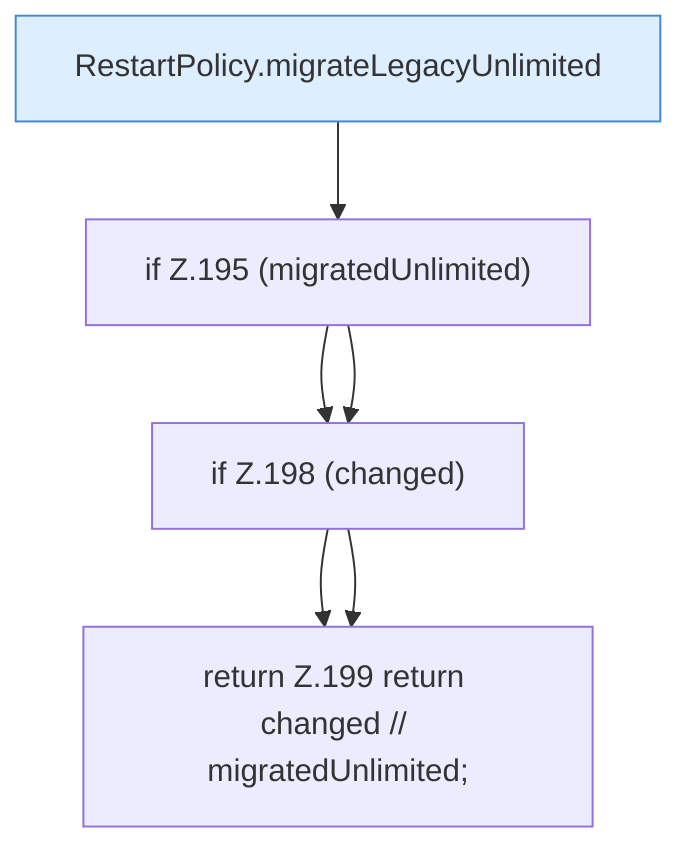

[[00 Start]] › [[Plugin-Kern]] › [[Lebenszyklus]] › [[FabricLauncherPlugin.migrateLegacyRestartPolicy]]

# FabricLauncherPlugin.migrateLegacyRestartPolicy

`FabricLauncherPlugin.migrateLegacyRestartPolicy(FileConfiguration config, String currentVersion)` [src/main/java/de/aichele/childlauncher/FabricLauncherPlugin.java:191–200](https://github.com/Sciddie/minecraft-serverhoster-plugin/blob/95b02b953b0b4c23673e900e021a7c3c844aa37d/src/main/java/de/aichele/childlauncher/FabricLauncherPlugin.java#L191-L200)



```knoten
RestartPolicy.migrateLegacyUnlimited
  Dieser Teil übernimmt den alten Wert von den alten Weg. Im [[Glossar#Quelltext|Quelltext]] heißt das `migrateLegacyUnlimited`.
if Z.195 (migratedUnlimited)
  Hier fällt eine Entscheidung. Nur wenn sie zutrifft, geht es den Ja-Weg weiter. Das steht in [[Glossar#Zeile|Zeile]] 195.
if Z.198 (changed)
  Hier fällt eine Entscheidung. Nur wenn sie zutrifft, geht es den Ja-Weg weiter. Das steht in [[Glossar#Zeile|Zeile]] 198.
return Z.199 return changed // migratedUnlimited;
  Hier endet die [[Glossar#Funktion|Funktion]] und liefert ein Ergebnis zurück. Das steht in [[Glossar#Zeile|Zeile]] 199.
```

> [!knoten]- Was die Blöcke tun
> - **RestartPolicy.migrateLegacyUnlimited**: Dieser Teil übernimmt den alten Wert von den alten Weg. Im [[Glossar#Quelltext|Quelltext]] heißt das `migrateLegacyUnlimited`.
> - **if Z.195 (migratedUnlimited)**: Hier fällt eine Entscheidung. Nur wenn sie zutrifft, geht es den Ja-Weg weiter. Das steht in [[Glossar#Zeile|Zeile]] 195.
> - **if Z.198 (changed)**: Hier fällt eine Entscheidung. Nur wenn sie zutrifft, geht es den Ja-Weg weiter. Das steht in [[Glossar#Zeile|Zeile]] 198.
> - **return Z.199 return changed // migratedUnlimited;**: Hier endet die [[Glossar#Funktion|Funktion]] und liefert ein Ergebnis zurück. Das steht in [[Glossar#Zeile|Zeile]] 199.

- Dasselbe für eine noch ältere Schreibweise der [[Glossar#Neustart|Neustart]]-Regel.
