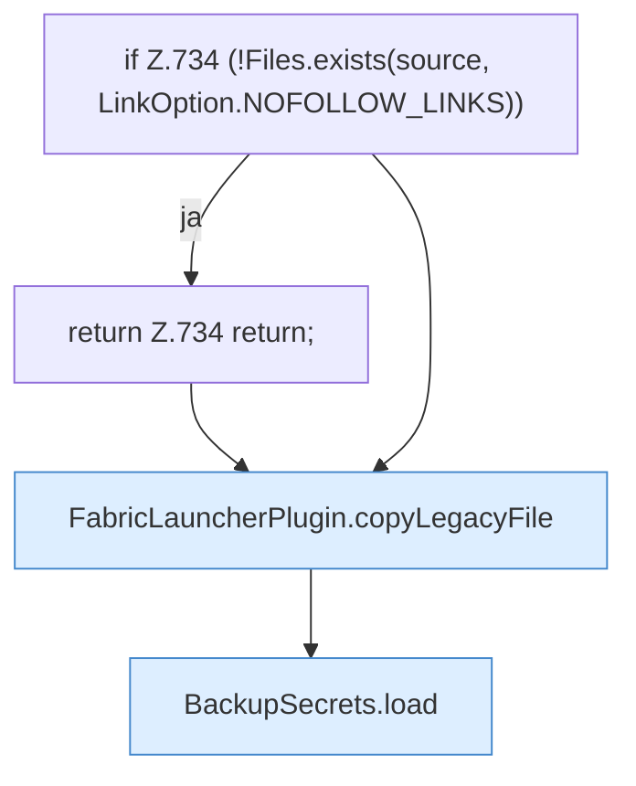

[[00 Start]] › [[Plugin-Kern]] › [[Setup]] › [[Setup-Import]] › [[FabricLauncherPlugin.migrateLegacySecrets]]

# FabricLauncherPlugin.migrateLegacySecrets

`FabricLauncherPlugin.migrateLegacySecrets(Path oldData)` [src/main/java/de/aichele/childlauncher/FabricLauncherPlugin.java:732–738](https://github.com/Sciddie/minecraft-serverhoster-plugin/blob/95b02b953b0b4c23673e900e021a7c3c844aa37d/src/main/java/de/aichele/childlauncher/FabricLauncherPlugin.java#L732-L738)



```knoten
if Z.734 (!Files.exists(source, LinkOption.NOFOLLOW_LINKS))
  Zeile 734: prüft `(!Files.exists(source, LinkOption.NOFOLLOW_LINKS))`.
return Z.734 return;
  Zeile 734: Rückgabe `return;`.
FabricLauncherPlugin.copyLegacyFile
  Das [[Glossar#Plugin|Plugin]] kopiert den alten Weg die Datei. Kopiert `copyLegacyFile`. Ruft `rejectSymbolicLinkSegments`.
BackupSecrets.load
  Dieser Teil lädt das. Lädt `load`. Ruft `restrict`.
```

> [!knoten]- Was die Blöcke tun
> - **if Z.734 (!Files.exists(source, LinkOption.NOFOLLOW_LINKS))**: Zeile 734: prüft `(!Files.exists(source, LinkOption.NOFOLLOW_LINKS))`.
> - **return Z.734 return;**: Zeile 734: Rückgabe `return;`.
> - **FabricLauncherPlugin.copyLegacyFile**: Das [[Glossar#Plugin|Plugin]] kopiert den alten Weg die Datei. Kopiert `copyLegacyFile`. Ruft `rejectSymbolicLinkSegments`.
> - **BackupSecrets.load**: Dieser Teil lädt das. Lädt `load`. Ruft `restrict`.

- Das [[Glossar#Plugin|Plugin]] übernimmt den alten Wert von den alten Weg die Zugangsdaten.
- `migrateLegacySecrets` in `src/main/java/de/aichele/childlauncher/FabricLauncherPlugin.java`
