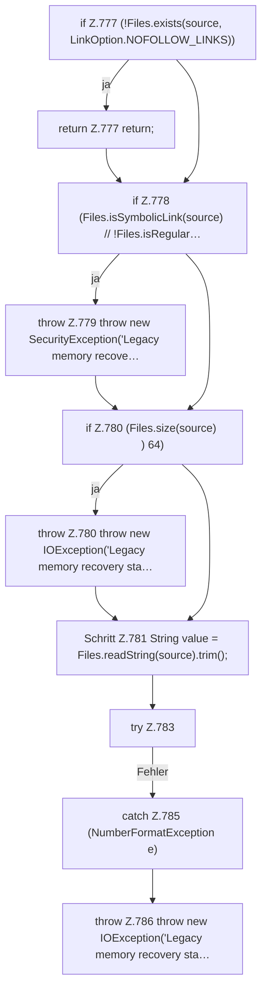

[[00 Start]] › [[Plugin-Kern]] › [[Setup]] › [[Setup-Import]] › [[FabricLauncherPlugin.migrateMemoryRecoveryState]] › [[FabricLauncherPlugin.migrateMemoryRecoveryState.Teil1]]

# FabricLauncherPlugin.migrateMemoryRecoveryState.Teil1

- Fortsetzung von `FabricLauncherPlugin.migrateMemoryRecoveryState`, Quellreihenfolge.
