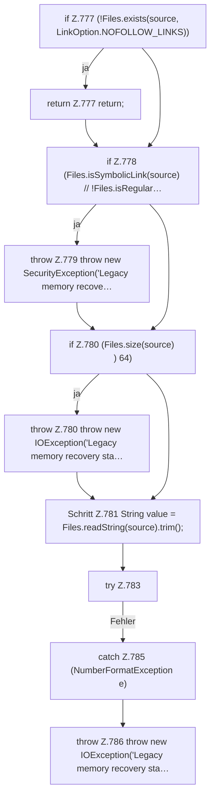

[[00 Start]] › [[Plugin-Kern]] › [[Setup]] › [[Setup-Import]] › [[FabricLauncherPlugin.migrateMemoryRecoveryState]] › [[FabricLauncherPlugin.migrateMemoryRecoveryState.Teil1]]

# FabricLauncherPlugin.migrateMemoryRecoveryState.Teil1



```knoten
if Z.777 (!Files.exists(source, LinkOption.NOFOLLOW_LINKS))
  Zeile 777: prüft `(!Files.exists(source, LinkOption.NOFOLLOW_LINKS))`.
return Z.777 return;
  Zeile 777: Rückgabe `return;`.
if Z.778 (Files.isSymbolicLink(source) // !Files.isRegular…
  Zeile 778: prüft `(Files.isSymbolicLink(source) // !Files.isRegular…`.
throw Z.779 throw new SecurityException('Legacy memory recove…
  Zeile 779: Abbruch `throw new SecurityException('Legacy memory recove…`.
if Z.780 (Files.size(source) ) 64)
  Zeile 780: prüft `(Files.size(source) ) 64)`.
throw Z.780 throw new IOException('Legacy memory recovery sta…
  Zeile 780: Abbruch `throw new IOException('Legacy memory recovery sta…`.
Schritt Z.781 String value = Files.readString(source).trim();
  Zeile 781: liest Text aus einer Datei. `String value = Files.readString(source).trim();`
try Z.783
  Zeile 783: Versuch. Der Fehlerpfad geht in catch.
catch Z.785 (NumberFormatException e)
  Zeile 785: fängt (NumberFormatException e).
throw Z.786 throw new IOException('Legacy memory recovery sta…
  Zeile 786: Abbruch `throw new IOException('Legacy memory recovery sta…`.
```

> [!knoten]- Was die Blöcke tun
> - **if Z.777 (!Files.exists(source, LinkOption.NOFOLLOW_LINKS))**: Zeile 777: prüft `(!Files.exists(source, LinkOption.NOFOLLOW_LINKS))`.
> - **return Z.777 return;**: Zeile 777: Rückgabe `return;`.
> - **if Z.778 (Files.isSymbolicLink(source) // !Files.isRegular…**: Zeile 778: prüft `(Files.isSymbolicLink(source) // !Files.isRegular…`.
> - **throw Z.779 throw new SecurityException('Legacy memory recove…**: Zeile 779: Abbruch `throw new SecurityException('Legacy memory recove…`.
> - **if Z.780 (Files.size(source) ) 64)**: Zeile 780: prüft `(Files.size(source) ) 64)`.
> - **throw Z.780 throw new IOException('Legacy memory recovery sta…**: Zeile 780: Abbruch `throw new IOException('Legacy memory recovery sta…`.
> - **Schritt Z.781 String value = Files.readString(source).trim();**: Zeile 781: liest Text aus einer Datei. `String value = Files.readString(source).trim();`
> - **try Z.783**: Zeile 783: Versuch. Der Fehlerpfad geht in catch.
> - **catch Z.785 (NumberFormatException e)**: Zeile 785: fängt (NumberFormatException e).
> - **throw Z.786 throw new IOException('Legacy memory recovery sta…**: Zeile 786: Abbruch `throw new IOException('Legacy memory recovery sta…`.

- Ein weiterer Abschnitt derselben Übersicht.
- Fortsetzung von `FabricLauncherPlugin.migrateMemoryRecoveryState`.
