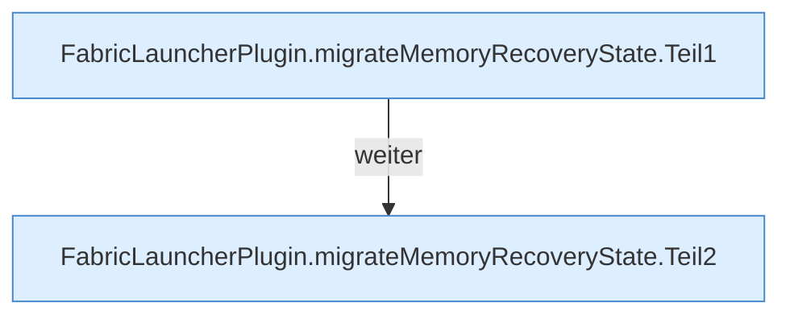

[[00 Start]] › [[Plugin-Kern]] › [[Setup]] › [[Setup-Import]] › [[FabricLauncherPlugin.migrateMemoryRecoveryState]]

# FabricLauncherPlugin.migrateMemoryRecoveryState

`FabricLauncherPlugin.migrateMemoryRecoveryState(Path oldData)` [src/main/java/de/aichele/childlauncher/FabricLauncherPlugin.java:775–792](https://github.com/Sciddie/minecraft-serverhoster-plugin/blob/95b02b953b0b4c23673e900e021a7c3c844aa37d/src/main/java/de/aichele/childlauncher/FabricLauncherPlugin.java#L775-L792)



```knoten
FabricLauncherPlugin.migrateMemoryRecoveryState.Teil1
  Ein weiterer Abschnitt derselben Übersicht. Abschnitt 1 dieses Ablaufs, in Quellreihenfolge.
FabricLauncherPlugin.migrateMemoryRecoveryState.Teil2
  Ein weiterer Abschnitt derselben Übersicht. Abschnitt 2 dieses Ablaufs, in Quellreihenfolge.
```

> [!knoten]- Was die Blöcke tun
> - **FabricLauncherPlugin.migrateMemoryRecoveryState.Teil1**: Ein weiterer Abschnitt derselben Übersicht. Abschnitt 1 dieses Ablaufs, in Quellreihenfolge.
> - **FabricLauncherPlugin.migrateMemoryRecoveryState.Teil2**: Ein weiterer Abschnitt derselben Übersicht. Abschnitt 2 dieses Ablaufs, in Quellreihenfolge.

- Das [[Glossar#Plugin|Plugin]] übernimmt den alten Wert von den [[Glossar#Arbeitsspeicher|Arbeitsspeicher]] die Wiederherstellung den Zustand.
- `migrateMemoryRecoveryState` in `src/main/java/de/aichele/childlauncher/FabricLauncherPlugin.java`
