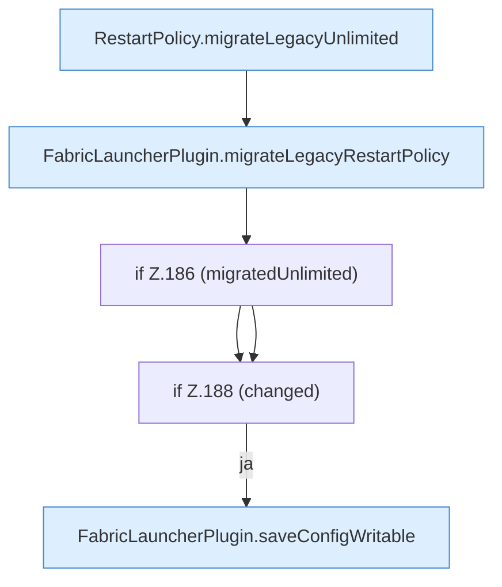

[[00 Start]] › [[Plugin-Kern]] › [[Lebenszyklus]] › [[FabricLauncherPlugin.migrateRestartPolicy]]

# FabricLauncherPlugin.migrateRestartPolicy

`FabricLauncherPlugin.migrateRestartPolicy()` [src/main/java/de/aichele/childlauncher/FabricLauncherPlugin.java:182–189](https://github.com/Sciddie/minecraft-serverhoster-plugin/blob/95b02b953b0b4c23673e900e021a7c3c844aa37d/src/main/java/de/aichele/childlauncher/FabricLauncherPlugin.java#L182-L189)



```knoten
RestartPolicy.migrateLegacyUnlimited
  Dieser Teil übernimmt den alten Wert von den alten Weg. Im [[Glossar#Quelltext|Quelltext]] heißt das `migrateLegacyUnlimited`.
FabricLauncherPlugin.migrateLegacyRestartPolicy
  Dasselbe für eine noch ältere Schreibweise der [[Glossar#Neustart|Neustart]]-Regel. Im [[Glossar#Quelltext|Quelltext]] heißt das `migrateLegacyRestartPolicy`.
if Z.186 (migratedUnlimited)
  Hier fällt eine Entscheidung. Nur wenn sie zutrifft, geht es den Ja-Weg weiter. Das steht in [[Glossar#Zeile|Zeile]] 186.
if Z.188 (changed)
  Hier fällt eine Entscheidung. Nur wenn sie zutrifft, geht es den Ja-Weg weiter. Das steht in [[Glossar#Zeile|Zeile]] 188.
FabricLauncherPlugin.saveConfigWritable
  Speichert die [[Glossar#Einstellungsdatei|Einstellungsdatei]] und setzt danach die [[Glossar#Dateirechte|Dateirechte]] so, dass sie beschreibbar bleibt. Im [[Glossar#Quelltext|Quelltext]] heißt das `saveConfigWritable`.
```

> [!knoten]- Was die Blöcke tun
> - **RestartPolicy.migrateLegacyUnlimited**: Dieser Teil übernimmt den alten Wert von den alten Weg. Im [[Glossar#Quelltext|Quelltext]] heißt das `migrateLegacyUnlimited`.
> - **FabricLauncherPlugin.migrateLegacyRestartPolicy**: Dasselbe für eine noch ältere Schreibweise der [[Glossar#Neustart|Neustart]]-Regel. Im [[Glossar#Quelltext|Quelltext]] heißt das `migrateLegacyRestartPolicy`.
> - **if Z.186 (migratedUnlimited)**: Hier fällt eine Entscheidung. Nur wenn sie zutrifft, geht es den Ja-Weg weiter. Das steht in [[Glossar#Zeile|Zeile]] 186.
> - **if Z.188 (changed)**: Hier fällt eine Entscheidung. Nur wenn sie zutrifft, geht es den Ja-Weg weiter. Das steht in [[Glossar#Zeile|Zeile]] 188.
> - **FabricLauncherPlugin.saveConfigWritable**: Speichert die [[Glossar#Einstellungsdatei|Einstellungsdatei]] und setzt danach die [[Glossar#Dateirechte|Dateirechte]] so, dass sie beschreibbar bleibt. Im [[Glossar#Quelltext|Quelltext]] heißt das `saveConfigWritable`.

- Übernimmt eine ältere Schreibweise der [[Glossar#Neustart|Neustart]]-Regel in die heutige.
