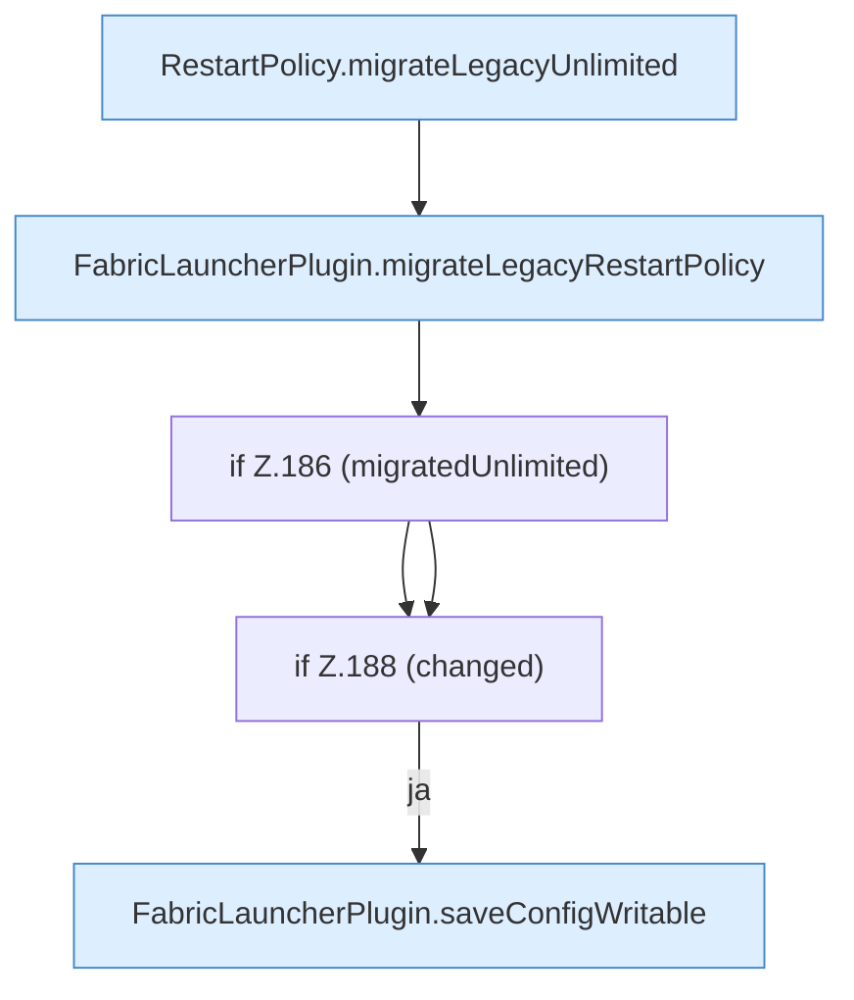

[[00 Start]] › [[Plugin-Kern]] › [[Lebenszyklus]] › [[FabricLauncherPlugin.migrateRestartPolicy]]

# FabricLauncherPlugin.migrateRestartPolicy

`FabricLauncherPlugin.migrateRestartPolicy()` [src/main/java/de/aichele/childlauncher/FabricLauncherPlugin.java:182–189](https://github.com/Sciddie/minecraft-serverhoster-plugin/blob/95b02b953b0b4c23673e900e021a7c3c844aa37d/src/main/java/de/aichele/childlauncher/FabricLauncherPlugin.java#L182-L189)



```knoten
RestartPolicy.migrateLegacyUnlimited
  Übernimmt den alten Wert von `migrateLegacyUnlimited`.
FabricLauncherPlugin.migrateLegacyRestartPolicy
  Übernimmt den alten Wert von `migrateLegacyRestartPolicy`. Ruft `migrateLegacyUnlimited`.
if Z.186 (migratedUnlimited)
  Zeile 186: prüft `(migratedUnlimited)`.
if Z.188 (changed)
  Zeile 188: prüft `(changed)`.
FabricLauncherPlugin.saveConfigWritable
  Speichert `saveConfigWritable`. Ruft `makeWritable`.
```

- `migrateRestartPolicy` in `src/main/java/de/aichele/childlauncher/FabricLauncherPlugin.java`
