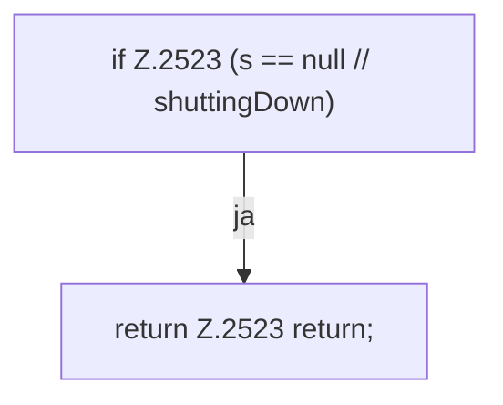

[[00 Start]] › [[Plugin-Kern]] › [[Befehle]] › [[FabricLauncherPlugin.msg]]

# FabricLauncherPlugin.msg

`FabricLauncherPlugin.msg(CommandSender s, String m)` [src/main/java/de/aichele/childlauncher/FabricLauncherPlugin.java:2522–2525](https://github.com/Sciddie/minecraft-serverhoster-plugin/blob/95b02b953b0b4c23673e900e021a7c3c844aa37d/src/main/java/de/aichele/childlauncher/FabricLauncherPlugin.java#L2522-L2525)

- `msg` in `src/main/java/de/aichele/childlauncher/FabricLauncherPlugin.java`
