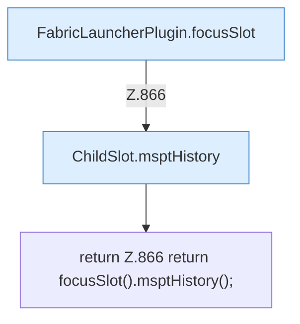

[[00 Start]] › [[Plugin-Kern]] › [[Diagnose]] › [[FabricLauncherPlugin.msptHistory()]]

# FabricLauncherPlugin.msptHistory()

`FabricLauncherPlugin.msptHistory()` [src/main/java/de/aichele/childlauncher/FabricLauncherPlugin.java:866–866](https://github.com/Sciddie/minecraft-serverhoster-plugin/blob/95b02b953b0b4c23673e900e021a7c3c844aa37d/src/main/java/de/aichele/childlauncher/FabricLauncherPlugin.java#L866-L866)



```knoten
FabricLauncherPlugin.focusSlot
  Das [[Glossar#Plugin|Plugin]] liefert den [[Glossar#Platz|Platz]]. Im [[Glossar#Quelltext|Quelltext]] heißt das `focusSlot`.
ChildSlot.msptHistory
  Dieser Teil kümmert sich um den Verlauf. Im [[Glossar#Quelltext|Quelltext]] heißt das `msptHistory`.
return Z.866 return focusSlot().msptHistory();
  Hier endet die [[Glossar#Funktion|Funktion]] und liefert ein Ergebnis zurück. Das steht in [[Glossar#Zeile|Zeile]] 866.
```

> [!knoten]- Was die Blöcke tun
> - **FabricLauncherPlugin.focusSlot**: Das [[Glossar#Plugin|Plugin]] liefert den [[Glossar#Platz|Platz]]. Im [[Glossar#Quelltext|Quelltext]] heißt das `focusSlot`.
> - **ChildSlot.msptHistory**: Dieser Teil kümmert sich um den Verlauf. Im [[Glossar#Quelltext|Quelltext]] heißt das `msptHistory`.
> - **return Z.866 return focusSlot().msptHistory();**: Hier endet die [[Glossar#Funktion|Funktion]] und liefert ein Ergebnis zurück. Das steht in [[Glossar#Zeile|Zeile]] 866.

- Liefert den Verlauf, wie lange ein [[Glossar#Spielschritt|Spielschritt]] jeweils gedauert hat.
- Auffällig: im normalen Betrieb ruft das niemand auf. Das nennt man [[Glossar#Ungenutzt|Ungenutzt]].
