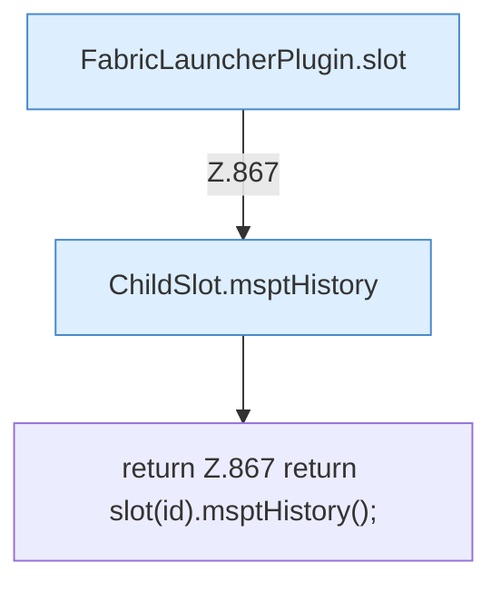

[[00 Start]] › [[Plugin-Kern]] › [[Diagnose]] › [[FabricLauncherPlugin.msptHistory(String)]]

# FabricLauncherPlugin.msptHistory(String)

`FabricLauncherPlugin.msptHistory(String id)` [src/main/java/de/aichele/childlauncher/FabricLauncherPlugin.java:867–867](https://github.com/Sciddie/minecraft-serverhoster-plugin/blob/95b02b953b0b4c23673e900e021a7c3c844aa37d/src/main/java/de/aichele/childlauncher/FabricLauncherPlugin.java#L867-L867)

- `msptHistory` in `src/main/java/de/aichele/childlauncher/FabricLauncherPlugin.java`
- Befund: toter Code, prüfen. src/main/java/de/aichele/childlauncher/FabricLauncherPlugin.java:867–867 kein Produktionsaufruf im Aufrufgraph; Name kommt in UI, Config oder anderem Text vor
