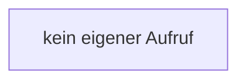

[[00 Start]] › [[Zeitplaene]] › [[Tasks]] › [[FabricLauncherPlugin.noteTask]]

# FabricLauncherPlugin.noteTask

`FabricLauncherPlugin.noteTask(String id, String state)` [src/main/java/de/aichele/childlauncher/FabricLauncherPlugin.java:1355–1357](https://github.com/Sciddie/minecraft-serverhoster-plugin/blob/95b02b953b0b4c23673e900e021a7c3c844aa37d/src/main/java/de/aichele/childlauncher/FabricLauncherPlugin.java#L1355-L1357)



```knoten
kein eigener Aufruf
  Dieser Abschnitt ruft keine weitere eigene [[Glossar#Funktion|Funktion]] auf.
```

> [!knoten]- Was die Blöcke tun
> - **kein eigener Aufruf**: Dieser Abschnitt ruft keine weitere eigene [[Glossar#Funktion|Funktion]] auf.

- Schreibt auf, dass eine [[Glossar#Aufgabe|Aufgabe]] gelaufen ist.
