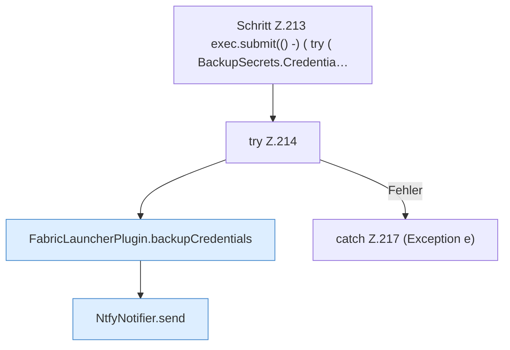

[[00 Start]] › [[Plugin-Kern]] › [[Benachrichtigung]] › [[FabricLauncherPlugin.notifyNtfy]] › [[FabricLauncherPlugin.notifyNtfy.Z212.Z213]]

# FabricLauncherPlugin.notifyNtfy.Z212.Z213



```knoten
Schritt Z.213 exec.submit(() -) ( try ( BackupSecrets.Credentia…
  Zeile 213: legt die Arbeit auf den Pool ServerhosterPlugin. `exec.submit(() -) ( try ( BackupSecrets.Credentia…`
try Z.214
  Zeile 214: Versuch. Der Fehlerpfad geht in catch.
FabricLauncherPlugin.backupCredentials
  Sichert `backupCredentials`. Ruft `load`.
NtfyNotifier.send
  Sendet `send`. Ruft `target`, `encodeHeader`, `validPriority`.
catch Z.217 (Exception e)
  Zeile 217: fängt (Exception e).
```

- Fortsetzung von `FabricLauncherPlugin.notifyNtfy.Z212`, Quellreihenfolge.
