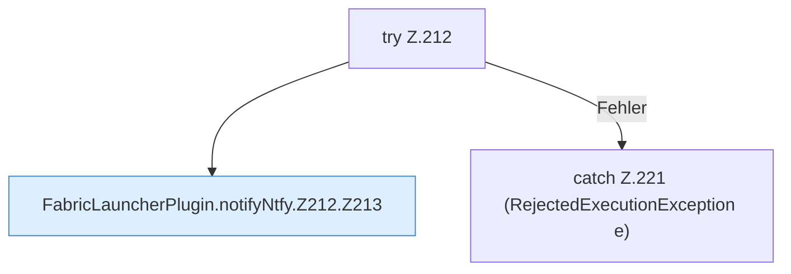

[[00 Start]] › [[Plugin-Kern]] › [[Benachrichtigung]] › [[FabricLauncherPlugin.notifyNtfy]] › [[FabricLauncherPlugin.notifyNtfy.Z212]]

# FabricLauncherPlugin.notifyNtfy.Z212

- Fortsetzung von `FabricLauncherPlugin.notifyNtfy`, Quellreihenfolge.
