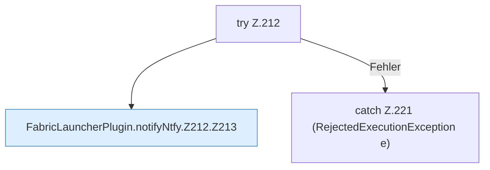

[[00 Start]] › [[Plugin-Kern]] › [[Benachrichtigung]] › [[FabricLauncherPlugin.notifyNtfy]] › [[FabricLauncherPlugin.notifyNtfy.Z212]]

# FabricLauncherPlugin.notifyNtfy.Z212



```knoten
try Z.212
  Zeile 212: Versuch. Der Fehlerpfad geht in catch.
FabricLauncherPlugin.notifyNtfy.Z212.Z213
  Der Ablauf geht in [[Glossar#Zeile|Zeile]] 213 weiter. Eine Ebene tiefer steht er genauer. Fortsetzung des Ablaufs ab Zeile 213.
catch Z.221 (RejectedExecutionException e)
  Zeile 221: fängt (RejectedExecutionException e).
```

> [!knoten]- Was die Blöcke tun
> - **try Z.212**: Zeile 212: Versuch. Der Fehlerpfad geht in catch.
> - **FabricLauncherPlugin.notifyNtfy.Z212.Z213**: Der Ablauf geht in [[Glossar#Zeile|Zeile]] 213 weiter. Eine Ebene tiefer steht er genauer. Fortsetzung des Ablaufs ab Zeile 213.
> - **catch Z.221 (RejectedExecutionException e)**: Zeile 221: fängt (RejectedExecutionException e).

- Der Ablauf geht in [[Glossar#Zeile|Zeile]] 212 weiter. Eine Ebene tiefer steht er genauer.
- Fortsetzung von `FabricLauncherPlugin.notifyNtfy`.
