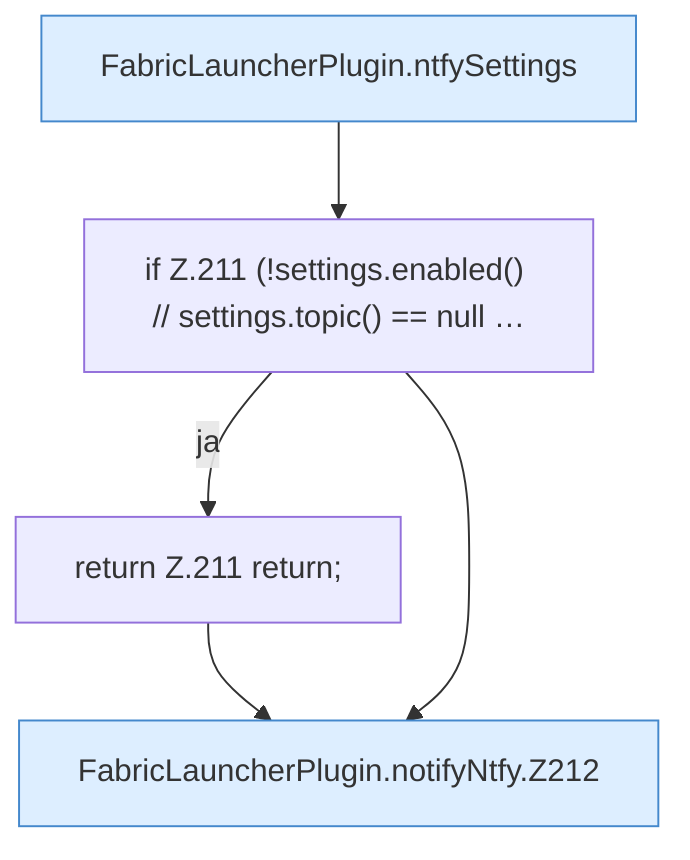

[[00 Start]] › [[Plugin-Kern]] › [[Benachrichtigung]] › [[FabricLauncherPlugin.notifyNtfy]]

# FabricLauncherPlugin.notifyNtfy

`FabricLauncherPlugin.notifyNtfy(String title, String message, String priority)` [src/main/java/de/aichele/childlauncher/FabricLauncherPlugin.java:209–224](https://github.com/Sciddie/minecraft-serverhoster-plugin/blob/95b02b953b0b4c23673e900e021a7c3c844aa37d/src/main/java/de/aichele/childlauncher/FabricLauncherPlugin.java#L209-L224)



```knoten
FabricLauncherPlugin.ntfySettings
  Liest die [[Glossar#Einstellungen|Einstellungen]] für den Mitteilungsdienst. Im [[Glossar#Quelltext|Quelltext]] heißt das `ntfySettings`.
if Z.211 (!settings.enabled() // settings.topic() == null …
  Hier fällt eine Entscheidung. Nur wenn sie zutrifft, geht es den Ja-Weg weiter. Das steht in [[Glossar#Zeile|Zeile]] 211.
return Z.211 return;
  Hier endet die [[Glossar#Funktion|Funktion]] und liefert ein Ergebnis zurück. Das steht in [[Glossar#Zeile|Zeile]] 211.
FabricLauncherPlugin.notifyNtfy.Z212
  Der Ablauf geht in [[Glossar#Zeile|Zeile]] 212 weiter. Eine Ebene tiefer steht er genauer. Im [[Glossar#Quelltext|Quelltext]] heißt das `Z212`.
```

> [!knoten]- Was die Blöcke tun
> - **FabricLauncherPlugin.ntfySettings**: Liest die [[Glossar#Einstellungen|Einstellungen]] für den Mitteilungsdienst. Im [[Glossar#Quelltext|Quelltext]] heißt das `ntfySettings`.
> - **if Z.211 (!settings.enabled() // settings.topic() == null …**: Hier fällt eine Entscheidung. Nur wenn sie zutrifft, geht es den Ja-Weg weiter. Das steht in [[Glossar#Zeile|Zeile]] 211.
> - **return Z.211 return;**: Hier endet die [[Glossar#Funktion|Funktion]] und liefert ein Ergebnis zurück. Das steht in [[Glossar#Zeile|Zeile]] 211.
> - **FabricLauncherPlugin.notifyNtfy.Z212**: Der Ablauf geht in [[Glossar#Zeile|Zeile]] 212 weiter. Eine Ebene tiefer steht er genauer. Im [[Glossar#Quelltext|Quelltext]] heißt das `Z212`.

- Das [[Glossar#Plugin|Plugin]] meldet den Mitteilungsdienst.
