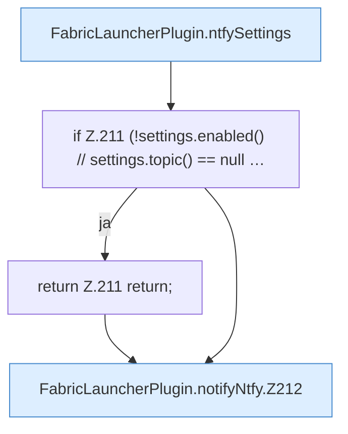

[[00 Start]] › [[Plugin-Kern]] › [[Benachrichtigung]] › [[FabricLauncherPlugin.notifyNtfy]]

# FabricLauncherPlugin.notifyNtfy

`FabricLauncherPlugin.notifyNtfy(String title, String message, String priority)` [src/main/java/de/aichele/childlauncher/FabricLauncherPlugin.java:209–224](https://github.com/Sciddie/minecraft-serverhoster-plugin/blob/95b02b953b0b4c23673e900e021a7c3c844aa37d/src/main/java/de/aichele/childlauncher/FabricLauncherPlugin.java#L209-L224)

- `notifyNtfy` in `src/main/java/de/aichele/childlauncher/FabricLauncherPlugin.java`
