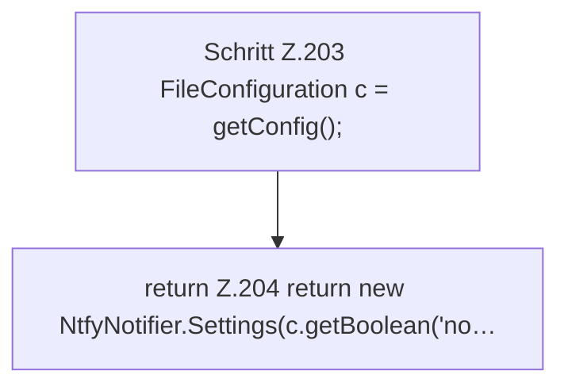

[[00 Start]] › [[Plugin-Kern]] › [[Benachrichtigung]] › [[FabricLauncherPlugin.ntfySettings]]

# FabricLauncherPlugin.ntfySettings

`FabricLauncherPlugin.ntfySettings()` [src/main/java/de/aichele/childlauncher/FabricLauncherPlugin.java:202–207](https://github.com/Sciddie/minecraft-serverhoster-plugin/blob/95b02b953b0b4c23673e900e021a7c3c844aa37d/src/main/java/de/aichele/childlauncher/FabricLauncherPlugin.java#L202-L207)



```knoten
Schritt Z.203 FileConfiguration c = getConfig();
  Ein einzelner Arbeitsschritt, ohne eine weitere eigene [[Glossar#Funktion|Funktion]] aufzurufen. Das steht in [[Glossar#Zeile|Zeile]] 203.
return Z.204 return new NtfyNotifier.Settings(c.getBoolean('no…
  Hier endet die [[Glossar#Funktion|Funktion]] und liefert ein Ergebnis zurück. Das steht in [[Glossar#Zeile|Zeile]] 204.
```

> [!knoten]- Was die Blöcke tun
> - **Schritt Z.203 FileConfiguration c = getConfig();**: Ein einzelner Arbeitsschritt, ohne eine weitere eigene [[Glossar#Funktion|Funktion]] aufzurufen. Das steht in [[Glossar#Zeile|Zeile]] 203.
> - **return Z.204 return new NtfyNotifier.Settings(c.getBoolean('no…**: Hier endet die [[Glossar#Funktion|Funktion]] und liefert ein Ergebnis zurück. Das steht in [[Glossar#Zeile|Zeile]] 204.

- Liest die [[Glossar#Einstellungen|Einstellungen]] für den Mitteilungsdienst.
