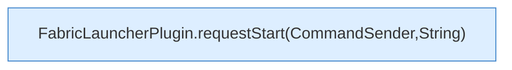

[[00 Start]] › [[Plugin-Kern]] › [[Befehle]] › [[FabricLauncherPlugin.onCommand]] › [[FabricLauncherPlugin.onCommand.Z2401.Case2402]]

# FabricLauncherPlugin.onCommand.Z2401.Case2402



```knoten
FabricLauncherPlugin.requestStart(CommandSender,String)
  Bittet darum, den [[Glossar#Spielserver|Spielserver]] zu starten. Fordert an `requestStart`. Ruft `startAsync`.
```

> [!knoten]- Was die Blöcke tun
> - **FabricLauncherPlugin.requestStart(CommandSender,String)**: Bittet darum, den [[Glossar#Spielserver|Spielserver]] zu starten. Fordert an `requestStart`. Ruft `startAsync`.

- Das Innere eines Wegs, ab [[Glossar#Zeile|Zeile]] 2402.
- Fortsetzung von `FabricLauncherPlugin.onCommand.Z2401`.
