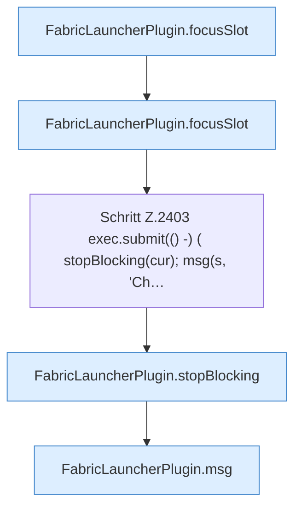

[[00 Start]] › [[Plugin-Kern]] › [[Befehle]] › [[FabricLauncherPlugin.onCommand]] › [[FabricLauncherPlugin.onCommand.Z2401.Case2403]]

# FabricLauncherPlugin.onCommand.Z2401.Case2403



```knoten
FabricLauncherPlugin.focusSlot
  Das [[Glossar#Plugin|Plugin]] liefert den [[Glossar#Platz|Platz]]. Liefert oder setzt den [[Glossar#Fokus|Fokus]] `focusSlot`. Ruft `slot`.
Schritt Z.2403 exec.submit(() -) ( stopBlocking(cur); msg(s, 'Ch…
  Zeile 2403: legt die Arbeit auf den Pool ServerhosterPlugin. `exec.submit(() -) ( stopBlocking(cur); msg(s, 'Ch…`
FabricLauncherPlugin.stopBlocking
  Setzt den Zustand auf „stoppt“ und wartet, bis der [[Glossar#Spielserver|Spielserver]] wirklich aus ist. Stoppt `stopBlocking`. Ruft `invalidateRestarts`, `running`, `stopProcess`.
FabricLauncherPlugin.msg
  Schickt eine [[Glossar#Zeile|Zeile]] an den Menschen, der einen [[Glossar#Befehl|Befehl]] getippt hat. Sendet eine Chat-Zeile `msg`.
```

> [!knoten]- Was die Blöcke tun
> - **FabricLauncherPlugin.focusSlot**: Das [[Glossar#Plugin|Plugin]] liefert den [[Glossar#Platz|Platz]]. Liefert oder setzt den [[Glossar#Fokus|Fokus]] `focusSlot`. Ruft `slot`.
> - **Schritt Z.2403 exec.submit(() -) ( stopBlocking(cur); msg(s, 'Ch…**: Zeile 2403: legt die Arbeit auf den Pool ServerhosterPlugin. `exec.submit(() -) ( stopBlocking(cur); msg(s, 'Ch…`
> - **FabricLauncherPlugin.stopBlocking**: Setzt den Zustand auf „stoppt“ und wartet, bis der [[Glossar#Spielserver|Spielserver]] wirklich aus ist. Stoppt `stopBlocking`. Ruft `invalidateRestarts`, `running`, `stopProcess`.
> - **FabricLauncherPlugin.msg**: Schickt eine [[Glossar#Zeile|Zeile]] an den Menschen, der einen [[Glossar#Befehl|Befehl]] getippt hat. Sendet eine Chat-Zeile `msg`.

- Das Innere eines Wegs, ab [[Glossar#Zeile|Zeile]] 2403.
- Fortsetzung von `FabricLauncherPlugin.onCommand.Z2401`.
