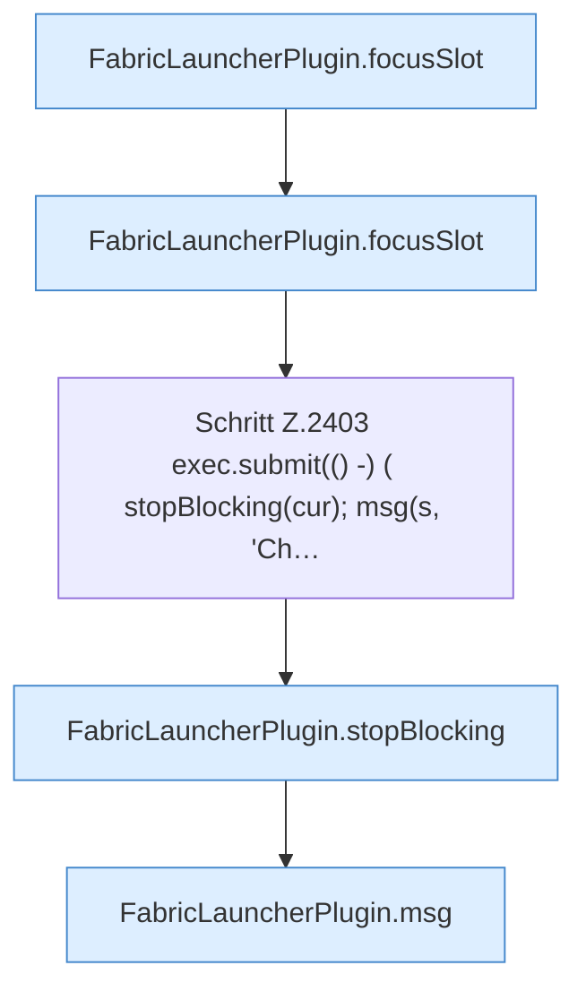

[[00 Start]] › [[Plugin-Kern]] › [[Befehle]] › [[FabricLauncherPlugin.onCommand]] › [[FabricLauncherPlugin.onCommand.Z2401.Case2403]]

# FabricLauncherPlugin.onCommand.Z2401.Case2403



```knoten
FabricLauncherPlugin.focusSlot
  Liefert oder setzt den Fokus `focusSlot`. Ruft `slot`.
Schritt Z.2403 exec.submit(() -) ( stopBlocking(cur); msg(s, 'Ch…
  Zeile 2403: legt die Arbeit auf den Pool ServerhosterPlugin. `exec.submit(() -) ( stopBlocking(cur); msg(s, 'Ch…`
FabricLauncherPlugin.stopBlocking
  Stoppt `stopBlocking`. Ruft `invalidateRestarts`, `running`, `stopProcess`.
FabricLauncherPlugin.msg
  Sendet eine Chat-Zeile `msg`.
```

- Fortsetzung von `FabricLauncherPlugin.onCommand.Z2401`, Quellreihenfolge.
