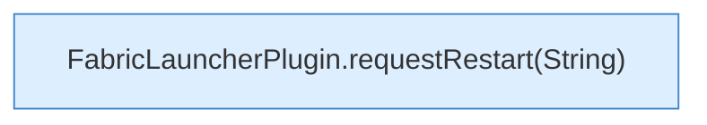

[[00 Start]] › [[Plugin-Kern]] › [[Befehle]] › [[FabricLauncherPlugin.onCommand]] › [[FabricLauncherPlugin.onCommand.Z2401.Case2404]]

# FabricLauncherPlugin.onCommand.Z2401.Case2404



```knoten
FabricLauncherPlugin.requestRestart(String)
  Fordert an `requestRestart`. Ruft `slot`, `stopBlocking`, `reloadProfiles`.
```

- Fortsetzung von `FabricLauncherPlugin.onCommand.Z2401`, Quellreihenfolge.
