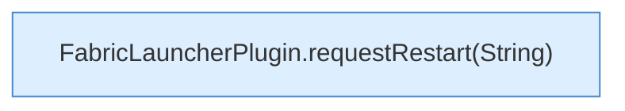

[[00 Start]] › [[Plugin-Kern]] › [[Befehle]] › [[FabricLauncherPlugin.onCommand]] › [[FabricLauncherPlugin.onCommand.Z2401.Case2404]]

# FabricLauncherPlugin.onCommand.Z2401.Case2404



```knoten
FabricLauncherPlugin.requestRestart(String)
  Bittet darum, den [[Glossar#Spielserver|Spielserver]] neu zu starten. Fordert an `requestRestart`. Ruft `slot`, `stopBlocking`, `reloadProfiles`.
```

> [!knoten]- Was die Blöcke tun
> - **FabricLauncherPlugin.requestRestart(String)**: Bittet darum, den [[Glossar#Spielserver|Spielserver]] neu zu starten. Fordert an `requestRestart`. Ruft `slot`, `stopBlocking`, `reloadProfiles`.

- Das Innere eines Wegs, ab [[Glossar#Zeile|Zeile]] 2404.
- Fortsetzung von `FabricLauncherPlugin.onCommand.Z2401`.
