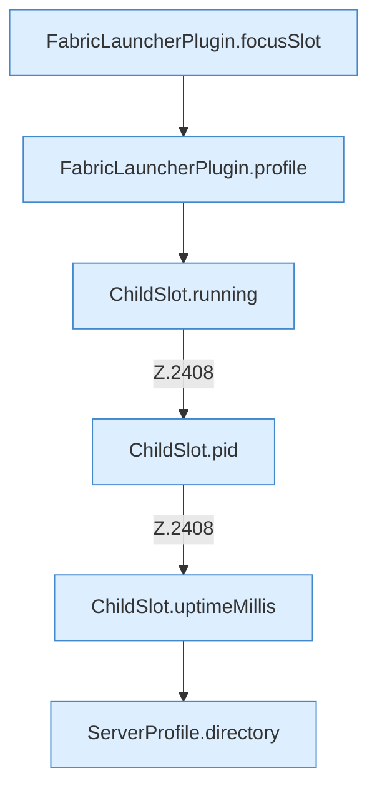

[[00 Start]] › [[Plugin-Kern]] › [[Befehle]] › [[FabricLauncherPlugin.onCommand]] › [[FabricLauncherPlugin.onCommand.Z2401.Case2405]]

# FabricLauncherPlugin.onCommand.Z2401.Case2405



```knoten
FabricLauncherPlugin.focusSlot
  Das [[Glossar#Plugin|Plugin]] liefert den [[Glossar#Platz|Platz]]. Liefert oder setzt den [[Glossar#Fokus|Fokus]] `focusSlot`. Ruft `slot`.
FabricLauncherPlugin.profile
  Das [[Glossar#Plugin|Plugin]] macht hier einen einzelnen Schritt. Eine Ebene tiefer steht er genauer. `profile` in `FabricLauncherPlugin.java`.
ChildSlot.running
  Dieser Teil prüft, ob läuft, das. Sagt, ob der [[Glossar#Prozess|Prozess]] läuft `running`.
ChildSlot.pid
  Dieser Teil macht hier einen einzelnen Schritt. Eine Ebene tiefer steht er genauer. Liefert die Prozessnummer `pid`.
ChildSlot.uptimeMillis
  Dieser Teil kümmert sich um die Zeit. Liefert die Laufzeit `uptimeMillis`. Ruft `running`.
ServerProfile.directory
  Die Serverbeschreibung macht hier einen einzelnen Schritt. Eine Ebene tiefer steht er genauer. `directory` in `ServerProfile.java`.
```

> [!knoten]- Was die Blöcke tun
> - **FabricLauncherPlugin.focusSlot**: Das [[Glossar#Plugin|Plugin]] liefert den [[Glossar#Platz|Platz]]. Liefert oder setzt den [[Glossar#Fokus|Fokus]] `focusSlot`. Ruft `slot`.
> - **FabricLauncherPlugin.profile**: Das [[Glossar#Plugin|Plugin]] macht hier einen einzelnen Schritt. Eine Ebene tiefer steht er genauer. `profile` in `FabricLauncherPlugin.java`.
> - **ChildSlot.running**: Dieser Teil prüft, ob läuft, das. Sagt, ob der [[Glossar#Prozess|Prozess]] läuft `running`.
> - **ChildSlot.pid**: Dieser Teil macht hier einen einzelnen Schritt. Eine Ebene tiefer steht er genauer. Liefert die Prozessnummer `pid`.
> - **ChildSlot.uptimeMillis**: Dieser Teil kümmert sich um die Zeit. Liefert die Laufzeit `uptimeMillis`. Ruft `running`.
> - **ServerProfile.directory**: Die Serverbeschreibung macht hier einen einzelnen Schritt. Eine Ebene tiefer steht er genauer. `directory` in `ServerProfile.java`.

- Das Innere eines Wegs, ab [[Glossar#Zeile|Zeile]] 2405.
- Fortsetzung von `FabricLauncherPlugin.onCommand.Z2401`.
